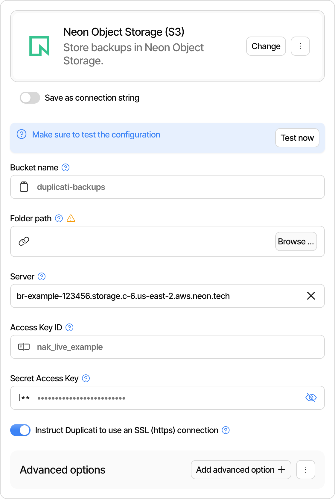

# Neon Object Storage Destination

Duplicati supports storing backups in [Neon Object Storage](https://neon.com/docs/storage/overview), an S3-compatible object storage service that is part of a Neon project. Duplicati connects to it with the [S3-compatible destination](../standard-based-destinations/s3-compatible-destination.md), so all the S3 options described on that page are also available here.

Neon Object Storage is scoped to a Neon branch. Every branch has its own S3 endpoint, and its own set of buckets and objects. This has a few consequences for backups:

* Bucket names only need to be unique within the branch, so a simple name such as `backups` is fine.
* When you create a child branch, it starts with a copy of the parent's buckets and objects. Changes made on the child do not affect the parent.
* Deleting a branch deletes the objects stored on it, including any backups. Store backups on a branch you intend to keep, such as the project's default branch.

Neon Object Storage is available in the `aws-us-east-1`, `aws-us-east-2`, `aws-eu-central-1` and `aws-ap-southeast-1` regions. See the [Neon documentation](https://neon.com/docs/storage/overview) for current availability.

## Preparing the bucket and credentials

You need three values from Neon: the branch endpoint, an access key id, and a secret access key. The examples below use the [Neon CLI](https://neon.com/docs/reference/neon-cli), with `<project-id>` and `<branch-id>` replaced by your own values.

Create a bucket on the branch:

```sh
neon buckets create duplicati-backups --project-id <project-id> --branch <branch-id>
```

Create a credential that can read and write objects on the branch:

```sh
neon credentials create --project-id <project-id> --branch <branch-id> \
  --name duplicati --scope storage:read --scope storage:write
```

The output contains a `token_id`, which is the access key id, and an `s3_secret_access_key`, which is the secret access key. Store the secret somewhere safe. If you lose it, show it again with `neon credentials reveal <token_id> --project-id <project-id> --branch <branch-id>`.

Look up the branch endpoint:

```sh
neon api --method GET /projects/<project-id>/branches/<branch-id>/storage
```

The `s3_endpoint` field in the response contains the endpoint, for example `https://br-example-123456.storage.c-6.us-east-2.aws.neon.tech`. Duplicati needs the hostname part, without `https://`.

## User interface

<figure><picture><source srcset="../../.gitbook/assets/neon-object-storage-dark.png" media="(prefers-color-scheme: dark)"></picture><figcaption></figcaption></figure>

In the destination list, choose **Neon Object Storage (S3)** and fill in these fields:

* **Bucket name**: the bucket you created, such as `duplicati-backups`.
* **Folder path**: an optional prefix for the backup files inside the bucket.
* **Server**: the hostname from the branch endpoint, such as `br-example-123456.storage.c-6.us-east-2.aws.neon.tech`.
* **Access Key ID**: the `token_id` of the credential.
* **Secret Access Key**: the `s3_secret_access_key` of the credential.

The option to use an SSL (https) connection is enabled by default for this destination. Leave it on, since Neon only accepts encrypted connections. No advanced options are required.

## URL format for Commandline

To use Neon Object Storage from the commandline, use the S3 URL format:

```
s3://<bucket>/<prefix>
  ?s3-server-name=<branch endpoint hostname>
  &use-ssl=true
  &aws-access-key-id=<token_id>
  &aws-secret-access-key=<s3_secret_access_key>
```

Make sure to include `use-ssl=true`. The S3 destination uses unencrypted connections by default, and Neon only accepts encrypted connections.

## Known limitations

Duplicati's regular backup, restore, verify, repair, delete and compact operations work with the default settings, including renames from `--soft-delete-prefix`. One S3 feature behaves differently on Neon:

* **Object locking.** Neon accepts object lock settings, and `--remote-file-lock-duration` runs without errors. Neon blocks deleting a locked file, but it does not keep object versions, so uploading a new file with the same name replaces the locked file and removes its lock. Anyone holding the access keys can overwrite your backups this way. Do not rely on Duplicati's object locking options to protect backups stored on Neon. See [S3 compatibility](https://neon.com/docs/storage/s3-compatibility) in the Neon documentation.
