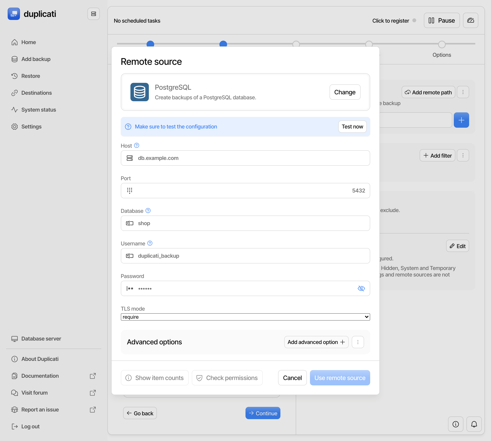

# PostgreSQL backup and restore

Duplicati can back up a PostgreSQL database directly from the server, without a dump file on disk. The database is added to a backup as a [remote source](../configuration-and-management/remote-sources.md), and Duplicati runs `pg_dump` against it each time the backup runs. A backup can be restored into the same database, into another database, or as plain files.


PostgreSQL backup and restore is available from canary 2.4.1.103. It supports PostgreSQL 14, 15, 16, 17 and 18.



If you do not want to run Duplicati yourself, the Duplicati Console can run the backup for you. See [Managed PostgreSQL backup](../../duplicati-console/managed-postgresql-backup.md).


## How it works

When the backup runs, Duplicati starts `pg_dump` and reads its output as a stream. The stream is split into one entry per table, so the rows of a table are stored, deduplicated and restored on their own. Nothing is written to the local disk on the way, so the database may be larger than the free space on the machine running Duplicati.

The dump is a single, consistent `pg_dump` of the database, including the schema, sequences, views, functions and the other objects of the database. Within the backup, the database is stored as:

| Entry                       | Contents                                                                                       |
| --------------------------- | ---------------------------------------------------------------------------------------------- |
| `toc`                       | The table of contents of the dump: every object of the database and how to create it           |
| `tables/<schema>.<table>`   | The rows of one table, in the text format of PostgreSQL's `COPY` command                       |
| `large-objects`             | The large objects of the database. Only present when large objects are included, see below     |

The entries appear below the folder that the remote source is mounted at, which is shown in the source tree like any other folder.

A backup covers exactly one database. To back up several databases, add a remote source for each, or create a backup for each.

## Requirements

### Client programs

Duplicati uses the PostgreSQL client programs `pg_dump`, `pg_restore` and `psql`, which must be installed on the machine that runs the backup. The programs must have the same major version as the server, so a PostgreSQL 16 server needs the version 16 programs. Duplicati reads the version of the server and looks for the matching programs in the standard installation folders:

* **Linux**: `/usr/lib/postgresql/<version>/bin`, as installed by the `postgresql-client-<version>` packages from the [PostgreSQL apt repository](https://wiki.postgresql.org/wiki/Apt).
* **macOS**: the folders of [Postgres.app](https://postgresapp.com/) and Homebrew.
* **Windows**: the folder of the PostgreSQL installer.

If the programs are not found there, the search path is used. You can also point Duplicati to the folder with the advanced option `--postgresql-client-path`.

Restoring into a database also needs client programs from the August 2025 releases or later (17.6, 16.10, 15.14, 14.19 or newer, or any version 18). Older releases are refused with a message, as they lack a safety feature that the restore relies on.

### A role for the backup

The backup only reads from the database, so use a role that can read everything and do nothing else, rather than the owner of the database. On PostgreSQL 14 and later, the built-in `pg_read_all_data` role grants read access to every table:

```sql
create role duplicati_backup login password '...' in role pg_read_all_data;
```

If any table uses [row-level security](https://www.postgresql.org/docs/current/ddl-rowsecurity.html), the role must also bypass it. Without this, the backup fails rather than storing a table with rows missing:

```sql
alter role duplicati_backup bypassrls;
```

On hosting platforms that do not allow `pg_read_all_data`, grant read access to each schema that is backed up instead:

```sql
create role duplicati_backup login password '...';
grant usage on schema public to duplicati_backup;
grant select on all tables in schema public to duplicati_backup;
```

A restore needs a role that can create and write objects, so it is often done with another role than the backup.

## Configure a PostgreSQL backup

[Set up a backup following the regular steps](../../getting-started/set-up-a-backup-in-the-ui.md). On the "Source Data" step, click "Add remote path", search for "postgres" and choose **PostgreSQL**. Fill in the connection details:

<figure><picture><source srcset="../../.gitbook/assets/ngclient-postgresql-remote-source-dark.png" media="(prefers-color-scheme: dark)"></picture><figcaption></figcaption></figure>

* **Host** and **Port**: The address of the database server. The port defaults to 5432.
* **Database**: The name of the database to back up.
* **Username** and **Password**: The role the backup connects as. The password is given to the client programs through their environment, never on a command line.
* **TLS mode**: How the connection is encrypted, with the `sslmode` values of PostgreSQL. The default is `require`, which always encrypts the connection. Use `verify-ca` or `verify-full` to also check the server certificate against a root certificate, which is set with the advanced options.

Click "Test now" to check the connection, and then "Use remote source". The database is now shown in the source tree.

Two buttons in the dialog run checks against the database:

* **Show item counts** shows the number of tables and the size of the database on the server.
* **Check permissions** checks the connection, the TLS encryption, the server version, whether the role can read every table, whether it bypasses row-level security where needed, the large objects, and warns if the role is a superuser.

### Block size

The rows of each table are stored in segments that are padded to the block size of the backup, so that a change to one part of a table does not change the blocks of the rest. A small block size makes the backup of a changing database much smaller. Set the [block size](../../technical-details/understanding-backup/backup-size-parameters.md) to `64KB` on the "Options" step when you create the backup:

```
--blocksize=64KB
```

The block size cannot be changed after the first backup has run. The managed PostgreSQL backup in the Duplicati Console uses 64 KB for this reason.

### Leave out tables

By default, every table is backed up. Expand the database in the source tree and click a table to leave it out, or add filters manually. A table is matched by the path of its entry, so the filter `-*/tables/public.audit_log` leaves out one table and `-*/tables/logs.*` leaves out a whole schema. See [Filters in Duplicati](../security-and-secrets/filters-in-duplicati.md) for the filter syntax.

The rows of a table that is left out are not read from the server at all, as Duplicati tells `pg_dump` to skip them. The table itself is still part of the table of contents, so a restore of the whole database creates it, with its indexes and constraints, but without rows.


If a table that is kept has a foreign key to a table that is left out, the foreign key cannot be created at restore, and the restore of the whole database fails. Leave out both tables, or neither.


### Large objects

[Large objects](https://www.postgresql.org/docs/current/largeobjects.html) are left out of the backup by default. Most applications do not use them, and a single large object that the role cannot read makes the whole dump fail. On PostgreSQL 17 and later, a grant on large objects only covers the objects that exist when it is made, so a new object can break the next backup.

To include them, set the advanced option `--postgresql-include-large-objects=true`. The role must then be able to read every large object. The large objects are stored together in a single entry, `large-objects`, so they deduplicate poorly if they change often.

## Configuration options

| Option                              | Description                                                                                                                       |
| ----------------------------------- | --------------------------------------------------------------------------------------------------------------------------------- |
| `postgresql-host`                   | The host name or address of the server. Required                                                                                  |
| `postgresql-port`                   | The port the server listens on. Defaults to 5432                                                                                  |
| `postgresql-database`               | The database to back up. Required                                                                                                 |
| `postgresql-username`               | The role to connect as. Required                                                                                                  |
| `postgresql-password`               | The password of the role                                                                                                          |
| `postgresql-sslmode`                | The TLS mode, with the values of PostgreSQL's `sslmode`. Defaults to `require`                                                    |
| `postgresql-sslrootcert`            | The path to a root certificate file to verify the server certificate against, for `verify-ca` and `verify-full`                   |
| `postgresql-sslrootcert-content`    | The root certificate as PEM text, for when there is no file to point to. Cannot be combined with `postgresql-sslrootcert`         |
| `postgresql-include-large-objects`  | Include the large objects in the backup. Defaults to `false`                                                                      |
| `postgresql-max-database-size`      | The largest size the database may have, as the server reports it. A backup of a larger database fails before anything is read     |
| `postgresql-client-path`            | The folder with `pg_dump`, `pg_restore` and `psql`, if they are not in a standard location                                       |

## Configure from the command line

On the command line, the database is given as a remote source path in the format `@<mount point>|<url>`, where the URL has no host part and all settings are options:

```sh
duplicati-cli backup <destination url> \
  "@/postgresql/shop|postgresql://?postgresql-host=db.example.com&postgresql-database=shop&postgresql-username=duplicati_backup&postgresql-password=..." \
  --blocksize=64KB
```

The tables are then stored as `/postgresql/shop/tables/<schema>.<table>`. The [SourceTool](../../duplicati-programs/command-line-interface-cli-1/sourcetool.md) can list the tables of a database URL without starting a dump.

## When a backup fails

* If Duplicati cannot connect, the server version is not supported, the matching client programs are missing, or `pg_dump` fails before it sends any data, the backup fails. No partial version is stored.
* If the connection is lost while the dump is being read, the backup completes with a warning that names the tables that were affected. The table that was being read when the dump stopped, and every table after it, keep the copy from the previous backup under their real names, so that a damaged copy never replaces a good one. The part of a table that did arrive is kept under the name `<table>.duplicati-partial`. The [retention rules](../configuration-and-management/retention-settings.md) cannot remove the last complete copy of a table this way.

A version made by a backup that failed part-way holds some tables from an earlier dump. Such a version is not a consistent database, and the restore of the whole database refuses it unless this is allowed explicitly, see below.

## Restore

A PostgreSQL backup can be restored into a database or as files. When you [restore](../../getting-started/restoring-files.md) from a backup with a database, the restore options offer:

* **Same PostgreSQL database**: Restores into the database the backup was taken from, with the credentials of the backup. The backup role may only be allowed to read, so this often needs another role.
* **Different PostgreSQL database**: Restores into another database, on the same or another server. Enter the connection details as for the backup.
* **Local file system**: Restores the entries as plain files.

Use the permission check to see if the target database is ready: it checks the connection, the server version, whether the role can create objects, and whether the database already has tables.

### Restoring the whole database

When everything in the version is selected, the whole database is restored. The objects are created first, then the rows of every table are loaded, and then the sequence values, the indexes and the constraints are applied. Each table is loaded in its own transaction and streamed directly into the server, so nothing the size of the database is written to the local disk.

* The target database must be empty. If it has tables, the restore stops before changing anything, unless **Replace the tables that exist in the database** is checked (`--overwrite`). The objects of the backup are then dropped and recreated in a single transaction, so if creating them fails, the database keeps what it had. Objects in the target that are not in the backup are not touched.
* Owners and grants are not restored. Everything is owned by the role that restores, so the restore works across servers where the role names differ.
* A whole database can be restored into a server of the same or a newer major version, but not an older one.
* A version where a backup failed part-way is refused, unless **Restore a version where a backup failed part-way** is checked (`--postgresql-restore-allow-mixed-versions`). The rows are loaded either way, but without the option, the indexes and constraints are not created and the restore is reported as failed.

### Restoring tables

When only some tables are selected, the rows of those tables are loaded into tables that already exist. Indexes, constraints, sequence values and other objects are not changed.

* A table that already has rows is not loaded, unless **Replace the rows of the tables** is checked (`--overwrite`), which empties the table first.
* **Create the tables that are missing** (`--postgresql-restore-create-tables`) creates a selected table that does not exist in the target. Only the table is created, without its indexes and constraints. This needs the `toc` entry, which is added to the restore automatically in the UI.
* The tables are loaded independently with their constraints in place. A table with a foreign key to another restored table can fail to load, and a table that other tables refer to cannot be replaced.

### Restore options

| Option                                      | Description                                                                                                                                           |
| ------------------------------------------- | ----------------------------------------------------------------------------------------------------------------------------------------------------- |
| `postgresql-restore-mode`                   | `database` (default) restores the whole database and needs every table of the version. `tables` only loads the rows of the restored tables            |
| `postgresql-restore-create-tables`          | In `tables` mode, create a restored table that does not exist, without indexes and constraints                                                         |
| `postgresql-restore-allow-mixed-versions`   | Restore the whole database from a version where the dump failed part-way                                                                             |
| `postgresql-restore-allow-missing-tables`   | Restore the whole database when some tables are not part of the restore, and create the indexes and constraints with those tables left empty          |
| `overwrite`                                 | Replace what exists in the target, as described above                                                                                                |

On the command line, the database is given as the restore path, with the same connection options as the source:

```sh
duplicati-cli restore <destination url> "*" \
  "--restore-path=@postgresql://?postgresql-host=db.example.com&postgresql-database=shop_restore&postgresql-username=restore_admin&postgresql-password=..."
```

Add `--dry-run` to check the target without changing it.

### Restore as files

The backup is a normal Duplicati backup, so it can also be restored as plain files, without a database and without the PostgreSQL client programs. A restored table is the `COPY` text of its rows, padded with NUL bytes to the block size. Remove the padding to get the rows:

```sh
tr -d '\000' < public.customers > customers.copy
```

The file can then be loaded with `\copy public.customers from 'customers.copy'` in `psql`.

## Hosting platform notes

The backup connects to the database like any other client, so it works with hosted PostgreSQL services as long as the server is reachable from the machine running Duplicati and accepts encrypted connections.

* **Supabase**: Use the session pooler connection string, which uses port 5432. Supabase uses row-level security, so the role always needs `bypassrls`.
* **Neon**: Use the connection string of the unpooled host. A suspended compute is woken by the backup.
* **Railway**: Use the `DATABASE_PUBLIC_URL` of the Postgres service. Railway bills egress per GB, and every backup transfers the whole dump.
* **Render**: Use the external database URL. Render does not allow `pg_read_all_data` or `bypassrls`, so grant read access per schema as shown above.
