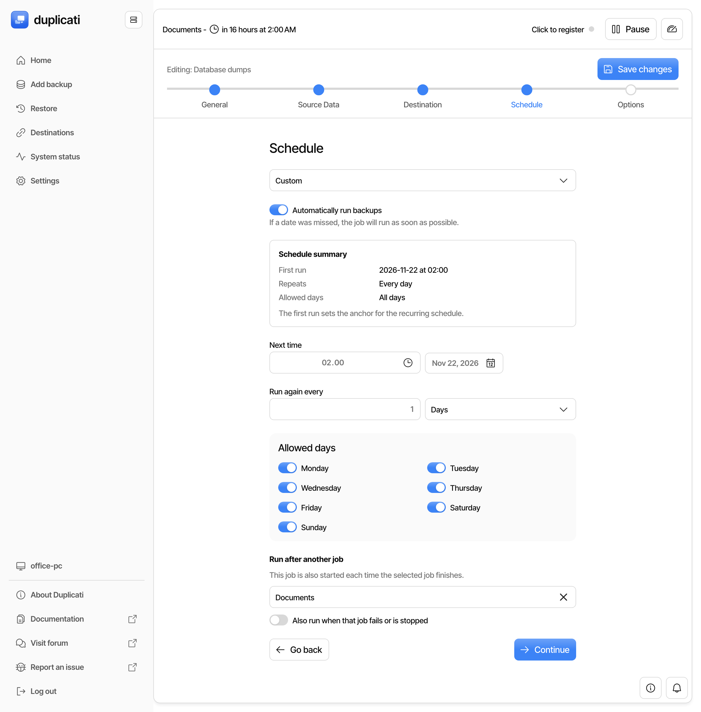
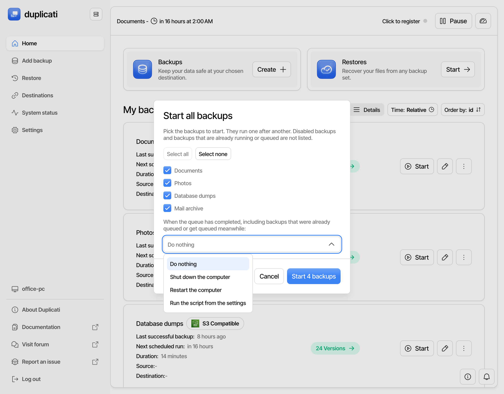
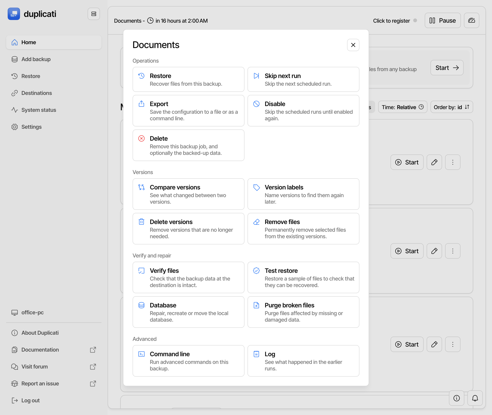

# Scheduling and running backups in order

Each backup in Duplicati can have its own schedule, as described in [Set up a backup in the UI](../../getting-started/set-up-a-backup-in-the-ui.md#id-4.-schedule). From Duplicati 2.4.1.103, backups can also be started after each other, all backups can be started at once with an action for when they are done, and a few options control what happens with scheduled runs that are late, too close together, or skipped on battery power.

All backups on a server share one queue, and only one task runs at a time. A backup that is started while another task runs waits in the queue until the earlier tasks are done.

## Running a backup after another backup

A backup can be set to start each time another backup finishes. This is useful when a backup depends on the result of another one, for example a backup that copies a database dump made by a script in another backup, or when backups to the same destination should not run at the same time.

To set it up, edit the backup that should run second, and go to the "Schedule" step. Under "Run after another job", pick the backup it should follow.

<figure><picture><source srcset="../../.gitbook/assets/ngclient-schedule-run-after-dark.png" media="(prefers-color-scheme: dark)"></picture><figcaption>
Running a backup after another backup
</figcaption></figure>

By default, the backup only starts when the other backup completes with a success or a warning. Turn on "Also run when that job fails or is stopped" to start it after every run, whatever the result.

The backup is started in addition to its own schedule. To run it only after the other backup, turn off its own schedule. If the backup it follows is disabled or has no schedule, the backup only runs after it when the other backup is started manually, and the "Schedule" step shows a warning about this.

Some details to be aware of:

* Chains are supported: backup C can run after B, which runs after A.
* Several backups can run after the same backup. They are queued in turn when it finishes.
* A backup cannot run after itself, and a setting that would form a loop, such as A after B and B after A, is refused when the backup is saved.
* A backup that is disabled is not started by the backup it follows.
* The setting is not kept when a backup is [exported](import-and-export-backup-configurations.md), as the backup it refers to may not exist on the server the file is imported on.

## Starting all backups

The home page has a "Start all" button that queues every enabled backup at once. When clicked, a dialog lists the backups, all of them picked. Remove the ones that should not run, and click the button to start the rest. They are queued in the order they are listed.

<figure><picture><source srcset="../../.gitbook/assets/ngclient-start-all-dark.png" media="(prefers-color-scheme: dark)"></picture><figcaption>
Starting all backups, and choosing what to do when they are done
</figcaption></figure>

### Shutting down or restarting when the queue is empty

The "Start all" dialog can also choose what the server does once the queue has run empty:

* **Do nothing**: the default.
* **Shut down the computer**.
* **Restart the computer**.
* **Run the script from the settings**: runs the script set on the "Settings" page, see below.

Only the actions that the server is allowed to perform on the computer are listed. Shutting down and restarting require that Duplicati runs with permission to do so, such as when it runs as a service or as an administrator.

The action is performed once, when no task is running or queued, including backups that were started after another backup. It is kept in memory only, so it is dropped if the server restarts before the queue is empty. If the queue is already empty when the backups are started, nothing is done.

### The post-queue script

To run your own script when the queue is empty, for example to shut down the computer in your own way or to notify another system, enter the full path to the script under "Script to run after the queue" on the "Settings" page. The path is stored in the `post-queue-processing-script` server setting. The script runs on the computer where the Duplicati server runs, and only when "Run the script from the settings" is chosen in the "Start all" dialog. On Windows, use a program or a batch file.

The script is started with the environment variable `DUPLICATI__EVENTNAME` set to `QUEUE-COMPLETED`, so the same script can be shared with the [scripts of a backup](../automation-and-integration/scripts.md). If the script fails or returns a non-zero exit code, a notification is shown. A script that is still running after a while is left running, but is no longer waited for.

## Skipping the next run

To skip only the next scheduled run of a backup, without disabling it, click "More actions" on the backup on the home page and choose "Skip next run". The schedule moves past the next run, and the backup runs again at the time after that.

<figure><picture><source srcset="../../.gitbook/assets/ngclient-backup-actions-dark.png" media="(prefers-color-scheme: dark)"></picture><figcaption>
The backup actions dialog with "Skip next run"
</figcaption></figure>

To skip all scheduled runs until further notice, choose "Disable" in the same dialog instead. See [Running a backup](../../getting-started/running-a-backup.md).

## Options for scheduled runs

The options below change how the scheduler treats a backup. They are set as advanced options on the backup, or as global options in the "Settings" page to apply to all backups. They only affect scheduled runs; a backup started manually, by another backup, or from the command line always runs.

The scheduler options are handled by the server, so they are no longer listed for the [command line](../../duplicati-programs/command-line-interface-cli.md), where they have no effect.

| Option | Description |
| ------ | ----------- |
| `--skip-missed-scheduled-backups` | By default, a scheduled run that was missed while Duplicati was not running, or while the machine was off or asleep, is started as soon as Duplicati notices it. With this option, such a run is skipped and the backup waits for its next scheduled time. A run counts as missed when its scheduled time is more than 10 minutes in the past. |
| `--min-time-between-scheduled-runs` | Skips a scheduled run if the last completed run of the backup finished less than this time ago, such as `2h`. This prevents a backup that runs longer than its interval from starting again right away. The skipped run is not queued later. |
| `--disable-on-battery` | Skips scheduled runs while the computer runs on battery power. If the power source is mains or unknown, the backup runs as usual. |
| `--run-skipped-on-ac-power` | Used together with `--disable-on-battery`. A scheduled run that was skipped on battery power is started once, as soon as the computer is no longer on battery power, provided the backup is still scheduled and enabled. Without this option, a skipped run waits for the next scheduled time. |

## Limiting how long a backup runs

A large backup, such as the first backup of a big source, can keep the other backups in the queue from running for a long time. Set `--max-backup-runtime` to stop the backup after it has run for a given time, such as `4h`. The backup then stops after the current file, as if it was stopped by the user, and is saved as a partial backup. The next run continues with the files that were not reached.

The volumes that are being made or uploaded when the time runs out are finished first, so the backup can run somewhat longer than the limit. A value without a unit is in seconds, and the default is no limit.
