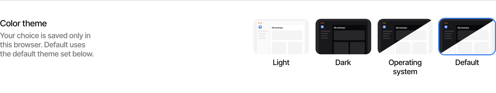

# User interface settings

Most settings of the user interface are on the "Settings" page, which is opened from the side menu. Some settings apply to the server and all browsers that use it, and some are stored only in the browser they were set in.

## Color theme

The "Color theme" setting chooses the theme for this browser: "Light", "Dark", "Operating system", which follows the light or dark mode of the operating system, or "Default", which uses the default theme of the server. The choice is stored in the browser only. The theme can also be changed from the theme button in the menu.

The "Default theme" setting chooses the theme for every browser where no theme has been chosen. Changing it does not override the choice made in a browser. The "Operating system" and "Default" choices are available from canary 2.4.1.103.

<figure><picture><source srcset="../../.gitbook/assets/ngclient-settings-theme-dark.png" media="(prefers-color-scheme: dark)"></picture><figcaption>
Choosing the color theme
</figcaption></figure>

## Security settings

* **Sign out when idle**: signs you out when the browser has not been used for the chosen time. See [Duplicati Access Password](duplicati-access-password.md#signing-out-when-idle).
* **HTTPS certificate**: uploads a certificate for the server to use for HTTPS. See [Configuring HTTPS](configuring-https.md#uploading-a-certificate-in-the-user-interface).
* **Script to run after the queue**: the script that can be run when all backups started with "Start all" are done. See [Scheduling and running backups in order](scheduling-and-running-backups-in-order.md#the-post-queue-script).

## Information about the server

The "About" page has several tabs with information about the server. From canary 2.4.1.103, the "General" tab also shows whether the [server database](../database-and-storage/the-server-database.md) is encrypted, and where the [preload settings](preload-settings.md) file `preload.json` is read from, which helps to find out which settings the server started with. It also shows the result of the last check for updates, such as "You are running the latest version", or the reason a check failed.

## Logs

The log pages, both the general and remote log of a backup and the stored and live server logs on the "About" page, have a "Download" button from canary 2.4.1.103. It downloads the entries that are loaded on the page, which is useful when reporting a problem. The side menu also has a "Report an issue" link.

## Alerts and notifications

Errors, warnings and other messages from the server are shown as notifications. From canary 2.4.1.103, the notification list and the alert history have a "Dismiss all" button that removes all of them at once, shown when there is more than one.

## Connection to the Duplicati Console

If the machine is connected to the [Duplicati Console](../../duplicati-console/connecting-to-the-duplicati-console.md), the connection status is shown in the user interface. From canary 2.4.1.103, it also shows when the connection is paused until a given time.
