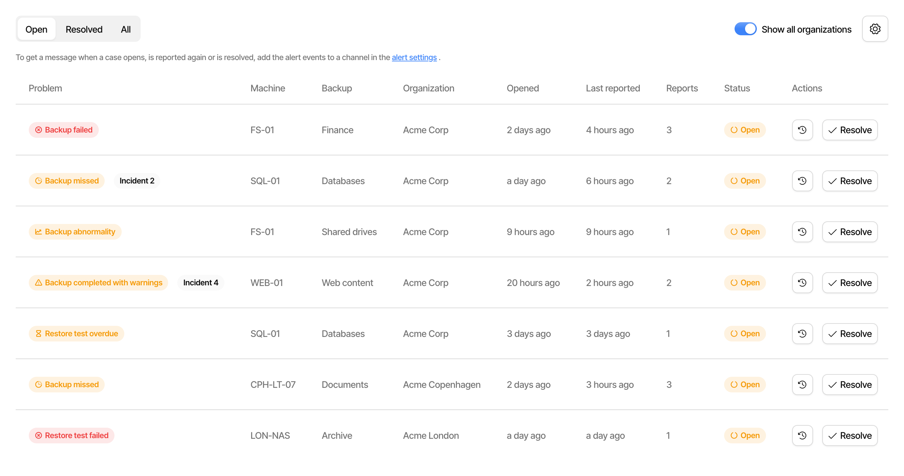
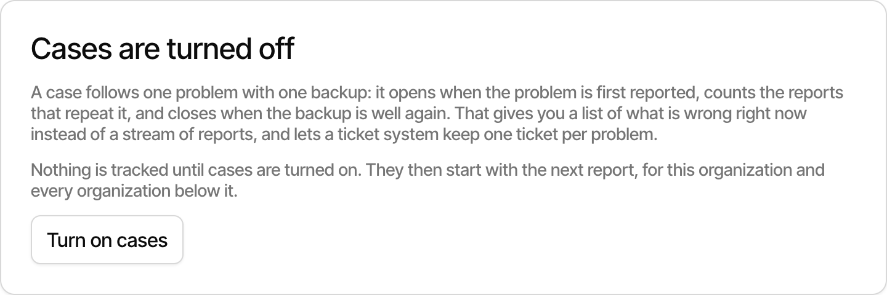
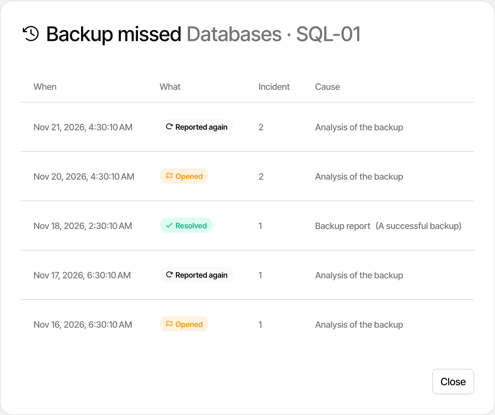

# Alert cases

Every backup report, restore test and analysis result that shows a problem raises an alert. When a backup fails every night for a week, that is seven alerts about the same problem, and it can be hard to see from the list of alerts which backups are failing right now and which have recovered.

An **alert case** follows one problem with one backup. It opens when the problem is first reported, counts the reports that repeat it, and closes when the backup is well again. The list of open cases is then a list of what is wrong right now, and a ticket system can keep one ticket per problem instead of one per report.

Cases are found in the Duplicati Console under **Alert Center → Cases**.

<figure><picture><source srcset="../.gitbook/assets/console-cases-list-dark.png" media="(prefers-color-scheme: dark)"></picture><figcaption></figcaption></figure>


Alert cases are an Enterprise feature, and a running Enterprise trial includes them. Without Enterprise, the **Cases** tab offers to start a trial or to upgrade.


## Turning cases on

Cases are turned off until an owner of the organization turns them on, and nothing is tracked before that. To turn them on, open the **Cases** tab and select **Turn on cases**. Tracking starts with the next report, so problems that were reported before cases were turned on do not get a case until they are reported again.

<figure><picture><source srcset="../.gitbook/assets/console-cases-off-dark.png" media="(prefers-color-scheme: dark)"></picture><figcaption></figcaption></figure>

When cases are turned on for an organization, they are also turned on for every organization below it. A sub-organization that has cases from an organization above it cannot turn them off, and the **Cases** tab says so.

To turn cases off, select the gear button at the top of the list and choose **Turn off cases**. Problems are then no longer tracked, and no more case notifications are sent. Cases that are open are left as they are and expire after a while, and you can turn cases on again at any time.

Cases are also turned off automatically if the organization no longer has an Enterprise subscription, for example when an Enterprise trial ends.

## What opens a case

There is at most one open case for each kind of problem on each backup. A case opens for these problems:

| Problem                         | Opened by                                                                                                    | Closed by                                                     |
| ------------------------------- | ------------------------------------------------------------------------------------------------------------ | ------------------------------------------------------------- |
| Backup failed                   | A backup report with errors                                                                                  | A successful backup, or a report with warnings                |
| Backup completed with warnings  | A backup report with warnings                                                                                | A successful backup, or a failed backup                       |
| Backup missed                   | A [monitoring profile](backup-monitoring.md) for missed backups                                              | A successful backup, a failed backup, or a report with warnings |
| Backup abnormality              | A [monitoring profile](backup-monitoring.md) for modified files or durations                                 | The next successful backup                                    |
| Restore test failed             | A failed restore test                                                                                        | A passing restore test                                        |
| Restore test overdue            | A [restore test policy](restore-test-policies.md) that finds the backup has not passed a restore test in time | A passing restore test                                        |

A backup only has one of the **Backup failed** and **Backup completed with warnings** cases open at a time: a report of one kind closes the other, so the open case always tells how the last backup went. Likewise, any report from a backup closes its **Backup missed** case, as the backup is no longer missing.

An abnormality is found by analyzing a backup report that itself says the backup succeeded. That report does not close the case it caused; the next successful backup does.


Missed backups, abnormalities and overdue restore tests come from the analysis of the reports, so a case only opens for them when a monitoring profile or a restore test policy covers the backup.


## The list of cases

The list shows the cases of the organization, with the most recently reported first. Use **Open**, **Resolved** and **All** to choose which cases to show. When the organization has sub-organizations, turn on **Show all organizations** to include their cases, with a column that tells which organization each case belongs to.

| Column        | Description                                                                                                                           |
| ------------- | ------------------------------------------------------------------------------------------------------------------------------------- |
| Problem       | The kind of problem. Problems where data is at risk now, such as a failed backup or a failed restore test, are shown in red.          |
| Machine       | The machine the backup runs on.                                                                                                       |
| Backup        | The backup the problem is about.                                                                                                      |
| Organization  | The organization of the backup. Only shown with **Show all organizations**.                                                           |
| Opened        | When the case opened. Hover to see the exact time.                                                                                    |
| Last reported | When the problem was last reported. Hover to see the exact time.                                                                      |
| Reports       | How many times the problem has been reported since the case opened, the first report included.                                       |
| Status        | **Open** or **Resolved**. Hover over **Resolved** to see what closed the case, and when.                                              |

### Incidents

When a problem comes back after its case was resolved, the same case opens again as a new **incident**. The first time a problem opens, it is incident 1, and the list shows an **Incident** chip when a problem has come back, for example **Incident 4** for a backup that has started showing warnings for the fourth time. A problem that keeps coming back is a sign that the cause has not been fixed.

## The history of a case

Select the history button on a case to see everything that happened to it, newest first, across all its incidents. Each entry tells when it happened, whether the case was opened, reported again or resolved, the incident, and what caused it, such as a backup report, the analysis of the backup, a restore test report or a restore test policy.

<figure><picture><source srcset="../.gitbook/assets/console-cases-history-dark.png" media="(prefers-color-scheme: dark)"></picture><figcaption></figcaption></figure>

## How a case is resolved

A case is resolved in one of these ways, which are shown when you hover over **Resolved** and in the history:

* **A successful backup** – A backup report showed that the backup is well again.
* **A passing restore test** – A restore test of the backup passed.
* **A later report** – A report of another kind replaced it, for example a failed backup that closes the warning case.
* **Closed by hand** – Someone selected **Resolve** on the case.
* **Expired** – The case was not reported again for 30 days, or the machine was removed from the organization.

Select **Resolve** on an open case to close it by hand, for example when the problem was dealt with outside the console, or nobody intends to fix it. If the problem is reported again, the case opens again as a new incident.

Cases that nothing will ever resolve are closed automatically. A case expires when the machine it belongs to is removed from the organization, or when the problem has not been reported again for 30 days, which covers a backup that was deleted from a machine that is still there.

## Notifications

Cases are tracked whether or not anybody is notified. To get a message when something happens to a case, add the alert events to a [notification channel](using-the-duplicati-console.md#notification-channels) under **Alert Center → Settings → Channels**:

| Event          | Event key        | Sent when                                                                        |
| -------------- | ---------------- | -------------------------------------------------------------------------------- |
| Alert Opened   | `alert.opened`   | A problem with a backup was found while no case for it was open                  |
| Alert Repeated | `alert.repeated` | The problem of an open case was reported again                                   |
| Alert Resolved | `alert.resolved` | An open case was closed, for any of the reasons above, including when it expires |

In the list of events for a channel, the alert events are marked **Enterprise** when the organization does not have Enterprise, and **Disabled** when cases are turned off. A channel can subscribe to them anyway, but nothing is sent until cases are active.


The alert events are well suited for a ticket system or an incident management tool connected through a webhook. Subscribe to **Alert Opened** to create a ticket, **Alert Resolved** to close it, and optionally **Alert Repeated** to add a comment. The alert case id and the incident number together identify one ticket: the id names the backup and the kind of problem, and the incident counts how many times the problem has opened. Each message also tells the machine, the backup, when the incident opened, and how many times the problem has been reported.


A channel can subscribe to both the alert events and the events of the individual reports, such as a failed backup. To avoid getting two messages for the same report, subscribe a channel to one or the other.
