# Backup configurations

A backup configuration is a backup job that is defined in the Duplicati Console and pushed to one or more connected machines. Instead of setting up the same backup on each machine, you create it once and assign it to the machines that should run it. When you change the configuration, the change is sent to every machine it is assigned to.

Configurations are found on the [**Configurations** tab](https://app.duplicati.com/app/machines/configurations) under **Machines**. The configurations run on the machines themselves, using either the [TrayIcon](../duplicati-programs/trayicon.md), the [Server](../duplicati-programs/server.md) or the [Agent](../duplicati-programs/agent.md). If you want the console to run a backup of Microsoft 365 or Google Workspace without a machine of your own, see [Managed Microsoft 365 backup](managed-microsoft-365-backup.md) and [Managed Google Workspace backup](managed-google-workspace-backup.md) instead.


Creating and assigning configurations requires an Enterprise subscription, which can also be an Enterprise trial. The Pro trial that starts when you connect your first machine does not include configurations. You must be an owner of the organization to create, change or assign a configuration.



Configurations are not available for an organization with [confidential processing](confidential-processing.md), and the **Configurations** tab is hidden for such an organization.


## How a configuration reaches a machine

A configuration is pushed to a machine in one of two ways:

- [**Assigned to a connected machine**](backup-configurations.md#assign-a-configuration-to-a-machine), which is done from the machine list.
- [**Added to a connection link**](backup-configurations.md#apply-a-configuration-with-a-connection-link), so each machine that registers with the link receives the configuration.

The console then sends the configuration to the machine, shortly after the assignment. If the machine is offline, it receives the configuration the next time it connects. A machine only receives configurations when it has a license, and not while it is waiting for [manual approval](connecting-to-the-duplicati-console.md#link-options).

Each configuration belongs to the organization it was created in, and can only be assigned to machines in that organization. Sub-organizations do not inherit configurations from the parent organization.

## The list of configurations

The list shows the configurations in the current organization with the destination, the schedule and a search field to find a configuration by name:

<figure><picture><source srcset="../.gitbook/assets/console-configurations-list-dark.png" media="(prefers-color-scheme: dark)">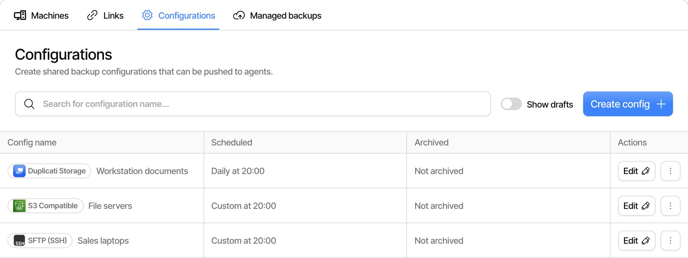</picture><figcaption></figcaption></figure>

Unfinished configurations are hidden from the list. Toggle **Show drafts** to see them. Use **Edit** to open a configuration, and the menu next to it to archive it, as described in [Remove a configuration](backup-configurations.md#remove-a-configuration).

## Create a configuration

Click **Create config** to start. The configuration is created as a draft right away, and is saved as a draft each time you click **Continue**, so you can leave at any step and continue later. The draft cannot be assigned to a machine until you click **Submit** on the last step.

You can jump between the steps by clicking them at the top of the page.

### General

Enter the **Backup name**, and choose how the backup is encrypted:

<figure><picture><source srcset="../.gitbook/assets/console-configurations-general-dark.png" media="(prefers-color-scheme: dark)">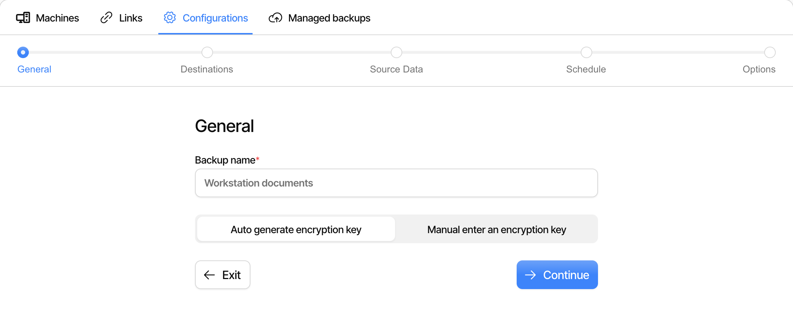</picture><figcaption></figcaption></figure>

- **Auto generate encryption key** creates a random key when you click **Submit**. The key is used by every machine that receives the configuration.
- **Manual enter an encryption key** uses a named key that is stored in the console. Select an existing key, or choose **Create new encryption key** to give a name and a value for a new one. A stored key can be used by several configurations.

<figure><picture><source srcset="../.gitbook/assets/console-configurations-general-manual-key-dark.png" media="(prefers-color-scheme: dark)">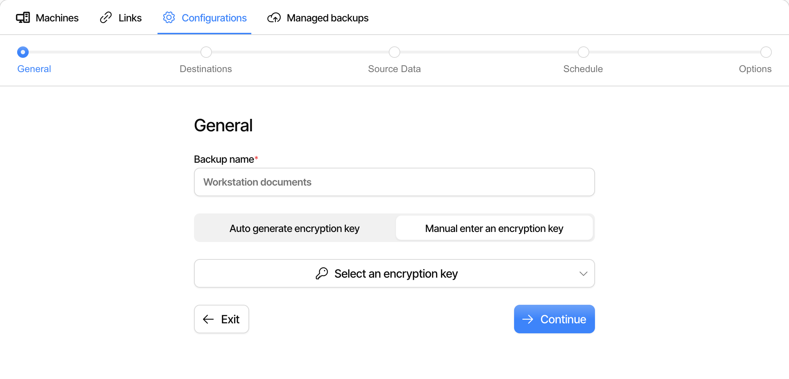</picture><figcaption></figcaption></figure>


To give each machine its own encryption key, and keep the key out of the console, use a secret manager on the machines. See [Use a secret manager on the machines](backup-configurations.md#use-a-secret-manager-on-the-machines).



The encryption choice cannot be changed after the configuration is submitted. The console rejects changes to the key, because the machines would no longer be able to read the existing backups.


### Destinations

Choose where the backups are stored. The list has the same [destinations](../backup-destinations/destination-overview.md) as the client, and you can use the search field to find one:

<figure><picture><source srcset="../.gitbook/assets/console-configurations-destination-list-dark.png" media="(prefers-color-scheme: dark)">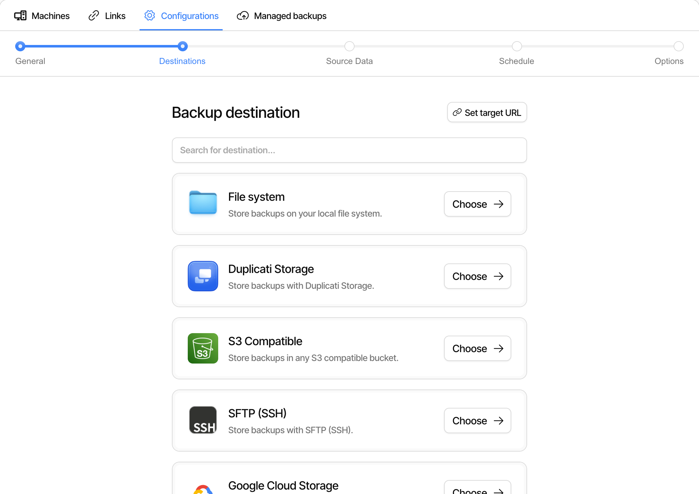</picture><figcaption></figcaption></figure>

After choosing a destination, fill in the fields for it. Use **Change** to pick another destination type. **Add advanced option** adds destination options, and the menu next to it lets you edit them as text:

<figure><picture><source srcset="../.gitbook/assets/console-configurations-destination-form-dark.png" media="(prefers-color-scheme: dark)">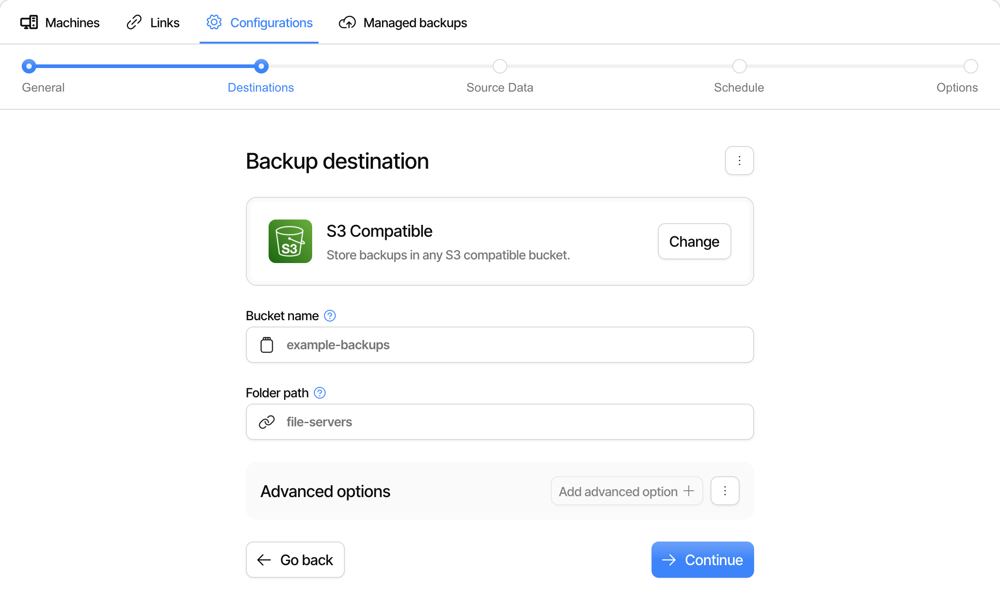</picture><figcaption></figcaption></figure>

If you already have the destination as a URL, use **Set target URL** at the top of the page. For an existing destination the same option is called **Edit target URL**, and is found in the menu at the top of the page together with **Copy url to clipboard**.

There are a few differences from setting up a destination in the client:

- The console does not test the connection, and you cannot browse for folders. The destination is first used when a machine runs the backup, so check the first run on one machine before you assign the configuration widely.
- Paths are evaluated on the machine. A **File system** path must exist on every machine that receives the configuration.
- Destinations that sign in with an AuthID have a button that creates the AuthID, and all machines then use the same AuthID.
- Credentials entered here are stored in the console and sent to every machine. To give each machine its own credentials instead, [use a secret manager on the machines](backup-configurations.md#use-a-secret-manager-on-the-machines).


Each machine needs its own destination folder, because two machines cannot share one backup. See [Use a configuration on several machines](backup-configurations.md#use-a-configuration-on-several-machines).


### Source Data

Add the folders to back up under **Paths**, using one entry for each path. The console has no access to the file system of the machines, so the paths are typed in, and they must match the operating system of the machines. Paths are given as on the client, which means a folder ends with a path separator, for instance `/srv/data/` or `C:\Data\`.

<figure><picture><source srcset="../.gitbook/assets/console-configurations-source-dark.png" media="(prefers-color-scheme: dark)">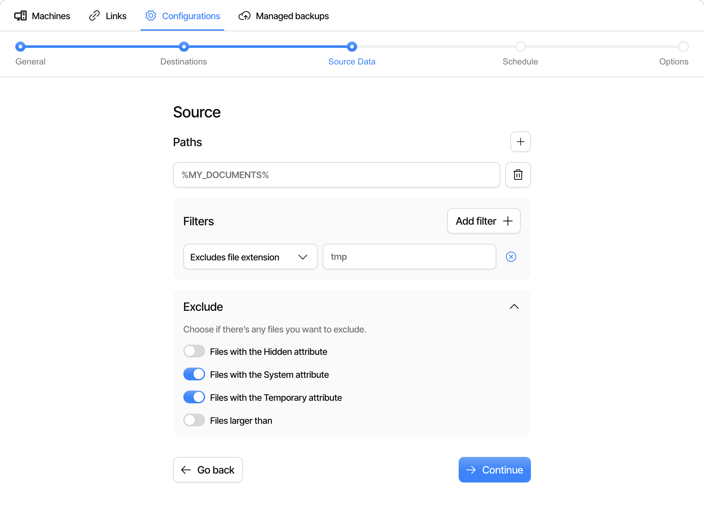</picture><figcaption></figcaption></figure>

Under **Filters**, click **Add filter** to include or exclude files. You can match on file extension, on names that contain a text, on a folder, on a regular expression, or on a predefined group of files such as temporary files or system files. The filters work as described in [Filters in Duplicati](../detailed-descriptions/security-and-secrets/filters-in-duplicati.md).

### Schedule

Pick **Daily 12:00**, **Weekdays 12:00** or **Weekly monday 12:00**, or pick **Manual** to set up the schedule yourself:

<figure><picture><source srcset="../.gitbook/assets/console-configurations-schedule-dark.png" media="(prefers-color-scheme: dark)">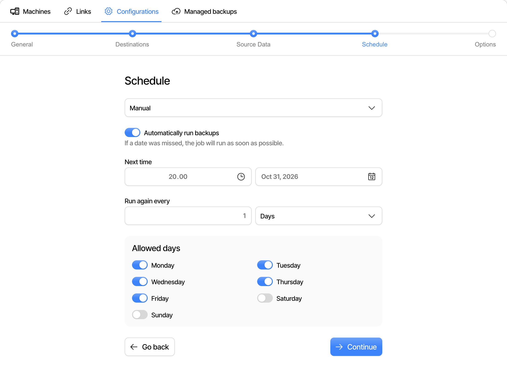</picture><figcaption></figcaption></figure>

With **Manual** you choose the next time the backup runs, how often it repeats and which days it is allowed to run on. Turn off **Automatically run backups** if the backup should not run on a schedule. Such a backup only runs when it is started on the machine.

If a machine is turned off at the scheduled time, the backup runs as soon as possible afterwards.

### Options

Choose the **Backup retention**, which works as described in [Retention settings](../detailed-descriptions/configuration-and-management/retention-settings.md):

<figure><picture><source srcset="../.gitbook/assets/console-configurations-options-dark.png" media="(prefers-color-scheme: dark)">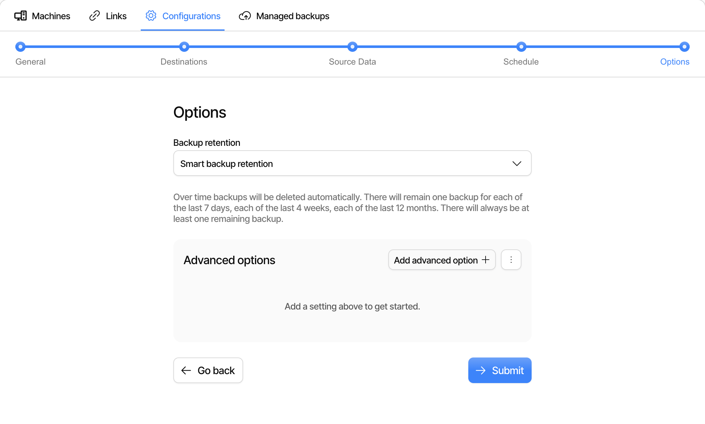</picture><figcaption></figcaption></figure>

| Option                             | Effect                                                                                  |
| ---------------------------------- | --------------------------------------------------------------------------------------- |
| Keep all backups                   | Nothing is deleted, and the backup grows with each change.                              |
| Delete backups that are older than | Versions older than the given time are deleted, as long as a newer version exists.      |
| Keep a specific number of backups  | The oldest versions are deleted when there are more than the given number.              |
| Smart backup retention             | Keeps one version for each of the last 7 days, the last 4 weeks and the last 12 months. |
| Custom backup retention            | Uses a retention expression, for instance `7D:1D,4W:1W,36M:1M`.                         |

Under **Advanced options** you can add any option for the backup, such as `dblock-size` for the remote volume size. The menu next to **Add advanced option** has **New custom option** for an option that is not in the list, and **Edit contents as text** to paste a list of options.

Click **Submit** to finish the configuration.

### Store the generated encryption key

If you chose **Auto generate encryption key**, the key is shown after you click **Submit**. Copy it to a safe place, check the box and click **Done**:

<figure><picture><source srcset="../.gitbook/assets/console-configurations-generated-key-dark.png" media="(prefers-color-scheme: dark)">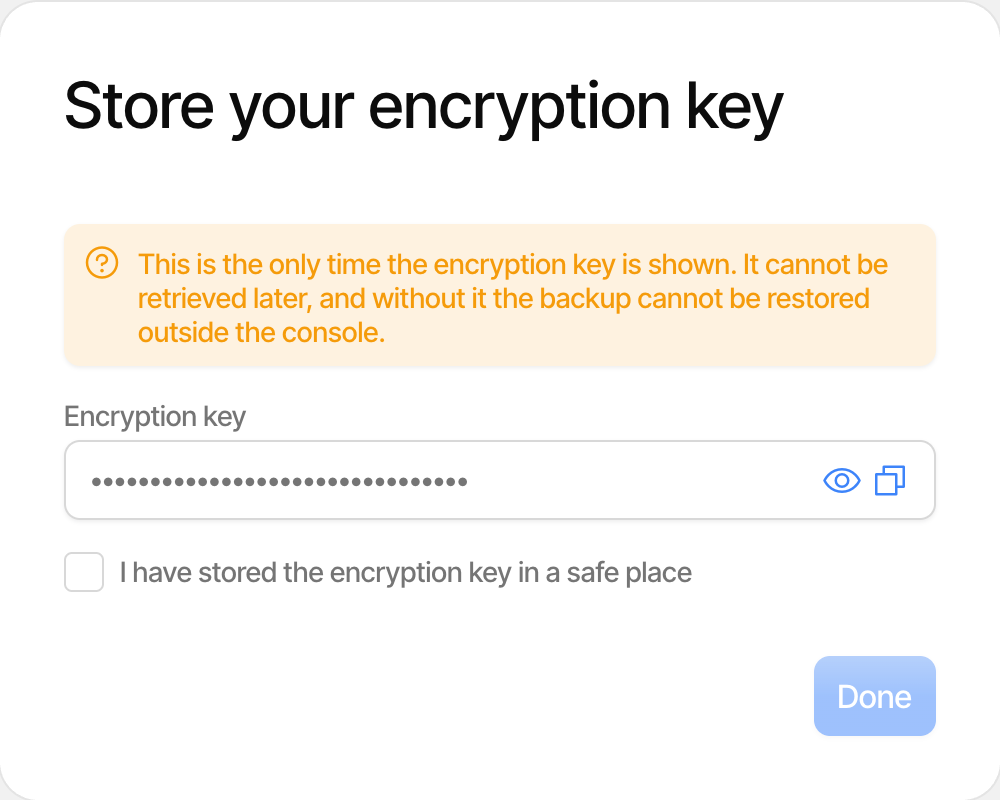</picture><figcaption></figcaption></figure>


The generated key is only shown once and cannot be retrieved later. Without it, the backup cannot be restored outside the console.


## Assign a configuration to a machine

To push configurations to a machine that is already connected:

1. Go to the [**Machines** tab](https://app.duplicati.com/app/machines).
2. Open the menu at the end of the row for the machine and choose **Assign Backups**.
3. Check the configurations the machine should have, uncheck the ones it should no longer have, and click **Save**.

<figure><picture><source srcset="../.gitbook/assets/console-machines-assign-backups-dark.png" media="(prefers-color-scheme: dark)">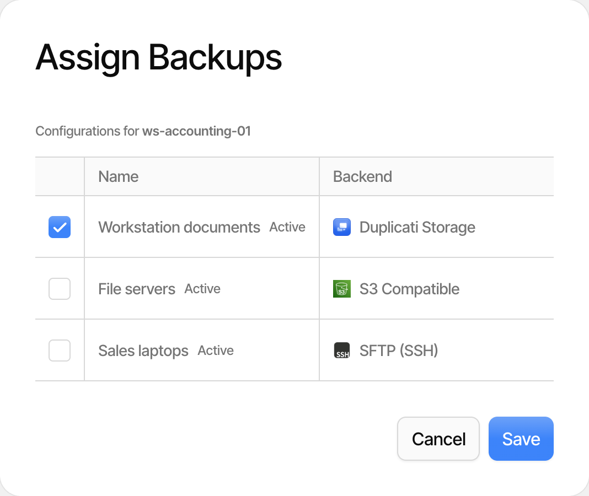</picture><figcaption></figcaption></figure>

You can see what each machine has by adding the **Assigned Backups** column to the machine list.

## Apply a configuration with a connection link

A [connection link](connecting-to-the-duplicati-console.md#connect-with-a-link) can carry configurations, so a machine has its backups from the moment it connects. This is the simplest way to roll out a standard backup to many new machines.

When you create or edit a link on the [**Links** tab](https://app.duplicati.com/app/machines/links), select the configurations under **Select configs to apply to this connection**. **Create new config** starts the steps above and returns to the link afterwards.

The configurations in a link are assigned when a machine registers with it. Changing the configurations in a link does not change machines that have already registered, so use **Assign Backups** for those.

## What happens on the machine

The backup shows up on the machine like any other backup, with the chip **Externally managed**. It runs on its schedule and can be started and restored on the machine as usual, but it cannot be edited, exported or deleted there. The **Edit in console** button on the backup opens the configuration in the console.

<figure><picture><source srcset="../.gitbook/assets/console-client-externally-managed-dark.png" media="(prefers-color-scheme: dark)">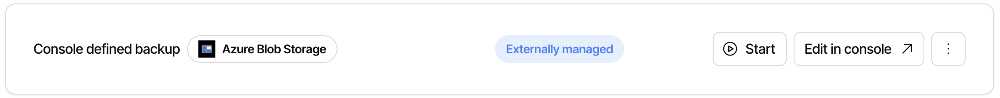</picture><figcaption></figcaption></figure>

If the connection to the console is removed on the machine, the backups that were pushed to it are removed from the machine as well.

## Use a configuration on several machines

Several machines can share a configuration, but each machine needs its own place to store the backup.

The simplest choice is [Duplicati Storage](duplicati-storage.md). Each machine has its own bucket, so a configuration with Duplicati Storage can be assigned to any number of machines. The machines need a storage API key, which is issued by default when a machine registers.

With any other destination, create one configuration for each machine, each with its own folder. The exception is when the credentials decide where the data ends up, such as an SFTP account that is locked to its own folder. A single configuration can then serve all machines if each machine has its own credentials from a [secret manager](backup-configurations.md#use-a-secret-manager-on-the-machines).

### Machine placeholders

The following placeholders are replaced with the value for each machine when the configuration is pushed:

| Placeholder      | Value                                  |
| ---------------- | -------------------------------------- |
| `${machineid}`   | The ID of the machine                  |
| `${machinename}` | The name of the machine in the console |
| `${orgid}`       | The ID of the organization             |

The placeholders can be used in the backup name, the source paths, the filters and the advanced options, for instance to give each machine a backup named `Documents on ${machinename}`.


Do not use the placeholders in the destination. The console URL-encodes the destination when it is saved, so the placeholder is not replaced. All machines would then use the same folder, with the placeholder text as part of the name.


### Use a secret manager on the machines

By default, the encryption key and the destination credentials are stored in the console and are the same on every machine. With a [secret provider](../detailed-descriptions/security-and-secrets/using-the-secret-provider/README.md) on the machines, the configuration only holds the name of a secret, and each machine looks up its own value when the backup runs. This means that:

- Each machine can have its own encryption key and its own credentials for the destination.
- The actual secrets are not stored in the console.

To set this up:

1. Set up a secret provider on each machine, for instance a [local provider](../detailed-descriptions/security-and-secrets/using-the-secret-provider/local-providers.md) or a [cloud provider](../detailed-descriptions/security-and-secrets/using-the-secret-provider/cloud-providers.md), with `--secret-provider` as described in [Using the secret provider](../detailed-descriptions/security-and-secrets/using-the-secret-provider/README.md#using-secret-provider-in-the-user-interface). The default secret provider for the operating system is not enough. The option can also be set with a [`preload.json`](../detailed-descriptions/configuration-and-management/preload-settings.md) file.
2. Store the secrets under the same names on each machine, with a value for that machine.
3. In the configuration, use the name of the secret with a `$` in front, in place of the value. The field must only hold that reference, as a secret cannot be part of a longer value.

For the encryption key, choose **Manual enter an encryption key**, choose **Create new encryption key** and enter the reference as the key value, for instance `$backup-passphrase`.

For the destination, enter the reference in the fields for the credentials, for instance `$s3-secret` as the password. This also works for options you add under **Add advanced option**. Secrets are only looked up in the options of the destination, so a reference cannot be used for the server name or the folder path.


If a machine cannot find a secret, the backup fails with a message that names the missing secret. Check that the secrets are in place before you assign the configuration to a machine.



The console does not know the value of the secrets, and cannot show them. Keep a copy of the encryption key for each machine outside the machine, or the backup cannot be restored if the machine is lost.


## Change a configuration

Click **Edit** in the list to change a configuration. The steps are the same as when creating it.


For a configuration that has been submitted, each **Continue** saves the changes and pushes them to the assigned machines, so the change does not wait for **Submit**.


A machine that is offline receives the changes when it next connects.

## Remove a configuration from a machine

Open **Assign Backups** for the machine and uncheck the configuration. The backup job is then removed from the machine.

The backup files at the destination are not deleted, so the data can still be [restored](../getting-started/restoring-files.md) with the encryption key. They must be deleted from the destination by hand if they are no longer needed.

If you assign the configuration to the machine again, the machine sets it up as a new backup with a new local database. The database must be recreated from the destination before the backup can continue.

## Remove a configuration

To remove a configuration completely, open the menu next to **Edit** and choose **Archive**. The dialog calls this deleting the configuration, and the configuration is removed from the list.

A configuration can only be archived when it is not in use, so you must first:

- Unassign it from all machines.
- Remove it from all connection links that have not expired.

Archiving does not delete any backups at the destination.
