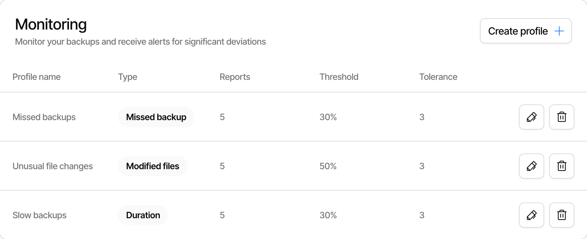
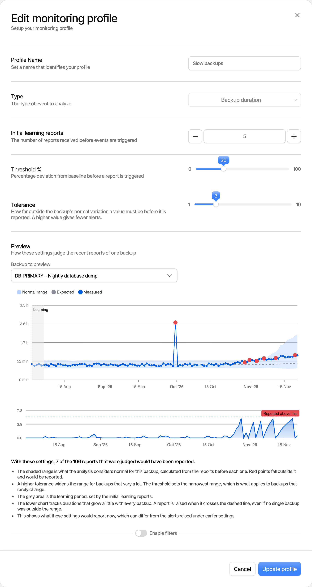
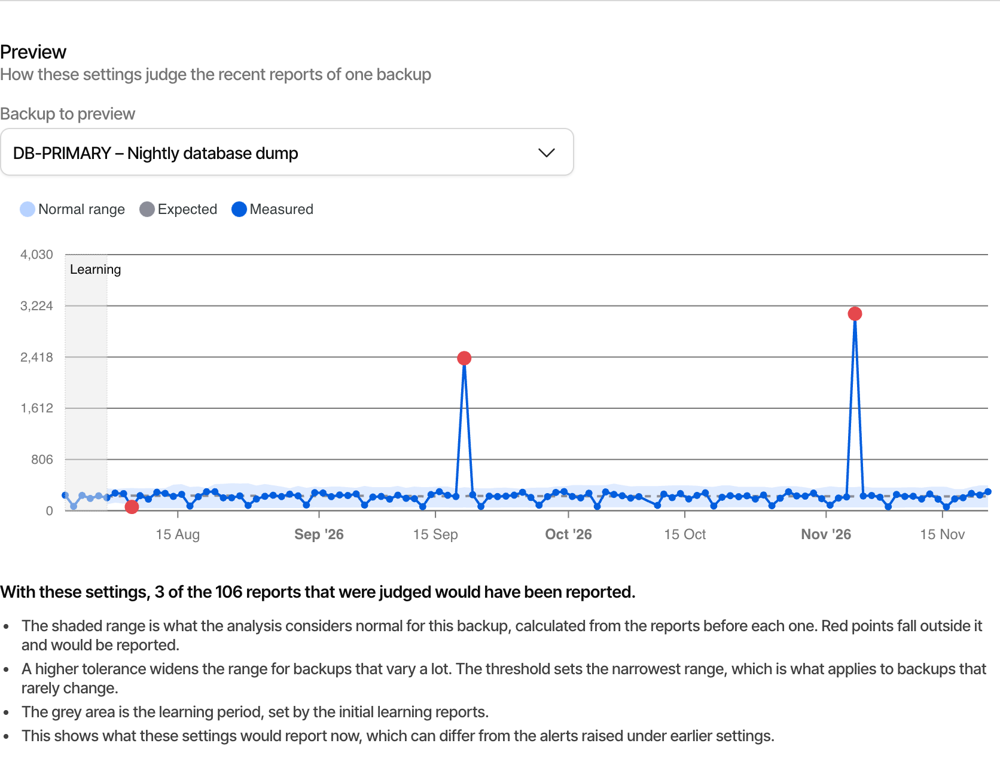
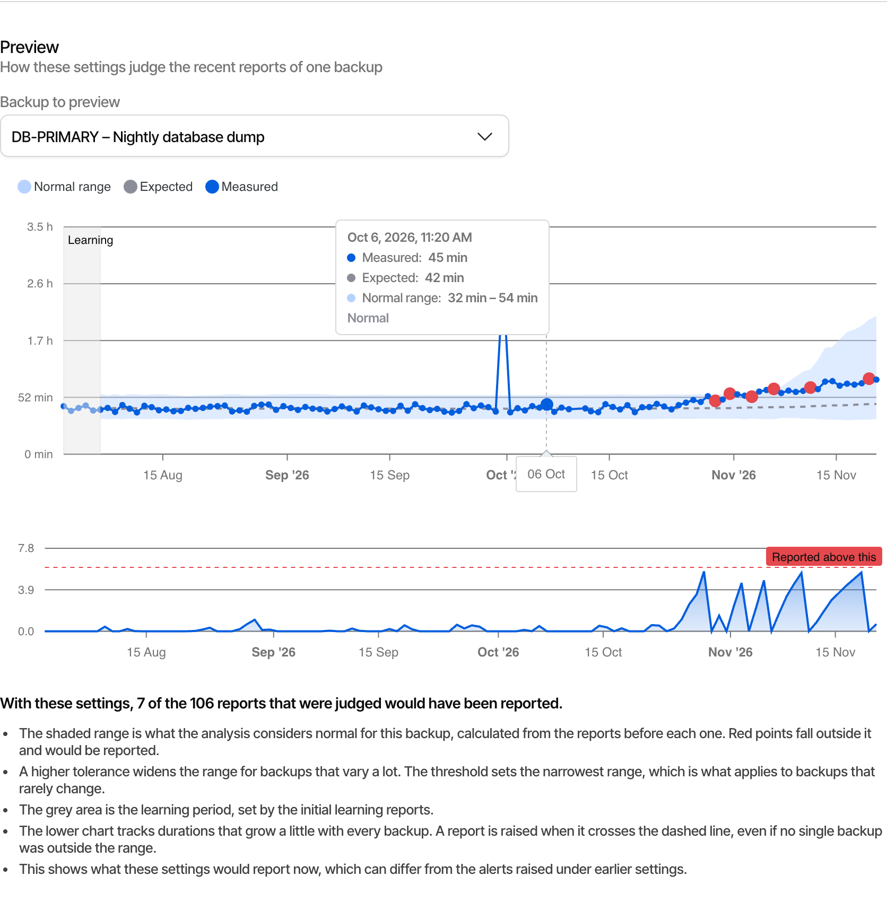
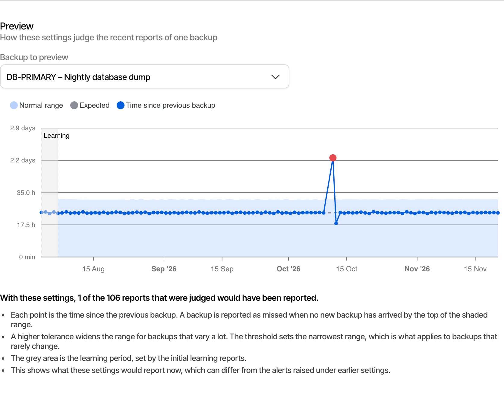
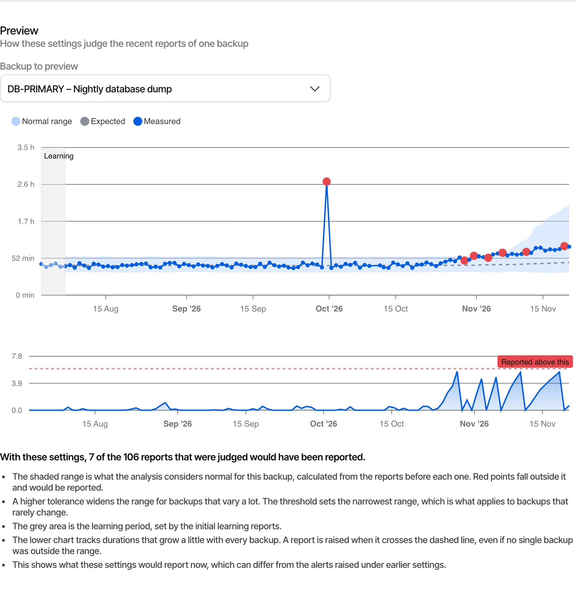

# Backup monitoring

A backup can complete without errors and still be a sign of trouble: a machine that stops running its backups, a backup that suddenly changes thousands of files, or a backup that takes a little longer every night. A **monitoring profile** watches the reports from your backups, learns what is normal for each backup, and raises an alert when a report falls outside it.

Monitoring profiles are found in the Duplicati Console under **Alert Center → Settings → Monitoring**. Each profile watches one type of event, and can apply to all backups or only to some of them.

<figure><picture><source srcset="../.gitbook/assets/console-monitoring-profiles-dark.png" media="(prefers-color-scheme: dark)"></picture><figcaption></figcaption></figure>


Backup monitoring is a Pro feature. Profiles can be created on any plan, but the reports are only analyzed on Pro and Enterprise subscriptions.


## What a profile watches

| Type                     | What is measured                                         | Reported when                                                       |
| ------------------------ | -------------------------------------------------------- | ------------------------------------------------------------------- |
| Backup was missed        | The time between two backups                             | No new backup has arrived by the longest normal interval            |
| Number of modified files | The number of modified files in a backup                 | The count is far above or below what the backup normally changes    |
| Backup duration          | How long the backup took                                 | A backup is far slower or faster than normal, or slowly gets slower |

Failed backups are left out when file counts and durations are analyzed, as the numbers from a failed backup say nothing about a normal one. Restores and other operations are not counted as backups.

## How the analysis decides what is normal

The analysis keeps the most recent 56 reports for each backup, and uses them to calculate what is normal for that backup:

- The **expected value** is the median of the reports. A single unusual report does not move the median, so one large backup does not change what is expected of the next one.
- The **normal range** is calculated from how much the backup usually varies above and below the expected value. A backup that changes between 100 and 5,000 files every night gets a wide range, while a backup that always changes around 200 files gets a narrow one. The values are compared on a logarithmic scale, so a change from 100 to 200 files counts the same as a change from 1,000 to 2,000.
- Very small changes are never reported: a difference of a single file, or a backup that is less than a minute slower than expected, is always normal.

The analysis also adjusts to changes in how a backup behaves:

- When three reports in a row are outside the range in the same direction, the backup is taken to have changed for good, for example after a large amount of data was added to the source. The older reports are then no longer used, so the new level is not reported again and again.
- For missed backups, the interval is calculated for each weekday when there are enough reports from that weekday. A backup that runs on weekdays only is then not reported as missed on Saturday.
- For durations, the analysis also tracks a **slow increase**: each backup that is a little slower than expected adds to a sum, and a backup that is faster takes from it. When the sum crosses a limit, the backup is reported, even if no single backup was outside the range.

## The settings

<figure><picture><source srcset="../.gitbook/assets/console-monitoring-profile-dialog-dark.png" media="(prefers-color-scheme: dark)"></picture><figcaption></figcaption></figure>

| Setting                  | Description                                                                                                                                                                                                                                                         |
| ------------------------ | ------------------------------------------------------------------------------------------------------------------------------------------------------------------------------------------------------------------------------------------------------------------- |
| Profile Name             | A name that identifies the profile in the list and in the alerts.                                                                                                                                                                                                   |
| Type                     | The type of event to analyze. The type cannot be changed after the profile is created.                                                                                                                                                                              |
| Initial learning reports | The number of reports from a backup that the analysis learns from before it judges any. The smallest value is 3. A higher value gives a more reliable range for new backups, but they are not monitored until that number of reports has arrived.                 |
| Threshold %              | The smallest change, compared to the expected value, that can be reported. It sets the narrowest the normal range can be, which is what applies to backups that rarely change. With 30%, a backup that always takes 40 minutes is not reported until it takes more than 52 minutes. Must be above 0% and below 100%. |
| Tolerance                | How far outside the backup's normal variation a value must be before it is reported, from 1 to 10. A higher value widens the range for backups that vary a lot, and gives fewer alerts. For slow increases, the limit of the sum is twice the tolerance.         |

Below the settings, the filters decide which backups the profile applies to. Without filters, the profile applies to all backups in the organization. With filters, the profile applies to backups that match a machine ID, a backup ID, a machine name or a backup name.

## Preview the settings

It can be hard to tell from the numbers alone how a threshold or a tolerance will work on your backups. The **Preview** at the bottom of the settings shows how the settings would have judged the recent reports of one backup, so you can adjust them before saving the profile.

Choose the backup in **Backup to preview**. The list contains the backups on licensed machines in the organization, and when the profile has filters, a backup that matches them is chosen first. The preview is updated as you change the type, the initial learning reports, the threshold or the tolerance, and nothing is saved until you select **Create profile** or **Update profile**.

<figure><picture><source srcset="../.gitbook/assets/console-monitoring-preview-files-dark.png" media="(prefers-color-scheme: dark)"></picture><figcaption></figcaption></figure>

The preview replays the analysis over the most recent reports from the backup, up to 112 reports from the last two years, and judges each report against the reports before it, the same way it would be judged when it arrives. The chart shows:

- **Measured** – the value from each report, with a dot for each report.
- **Expected** – the dashed line is the value the analysis expected for each report.
- **Normal range** – the shaded band is the range the analysis considers normal for each report.
- **Red points** – the reports that would have been reported with these settings.
- **Learning** – the grey area at the start is the learning period, set by **Initial learning reports**. Reports in this period are not judged.
- **New level** – a marker where the analysis took the most recent reports as a new permanent level, and stopped using the older ones.

Below the chart, a summary tells how many of the judged reports would have been reported, for example "3 of the 106 reports that were judged would have been reported". Hover over a report to see its date, the measured and expected values, the normal range, and how it was judged.

<figure><picture><source srcset="../.gitbook/assets/console-monitoring-preview-tooltip-dark.png" media="(prefers-color-scheme: dark)"></picture><figcaption></figcaption></figure>

### Missed backups

For a profile of the type **Backup was missed**, each point is the time since the previous backup, and the chart only has an upper limit. A backup is reported as missed when no new backup has arrived by the top of the shaded range, so a point above the range is a backup that arrived after it was reported as missed.

<figure><picture><source srcset="../.gitbook/assets/console-monitoring-preview-missed-dark.png" media="(prefers-color-scheme: dark)"></picture><figcaption></figcaption></figure>

### Backup duration

For a profile of the type **Backup duration**, a second chart below the first shows the **accumulated increase** used to detect a slow increase. A report is raised when the sum crosses the dashed line, even if no single backup was outside the range. The details of such a report say that it would be reported as a slow increase.

<figure><picture><source srcset="../.gitbook/assets/console-monitoring-preview-duration-dark.png" media="(prefers-color-scheme: dark)"></picture><figcaption></figcaption></figure>

In this example, a single slow backup in October is reported because it is far outside the range. In November, the backup gets a little slower every night. The sum in the lower chart crosses the limit several times, so those backups are reported as a slow increase. Each time a slow increase is reported, the sum starts over from zero.

### Using the preview to tune a profile

- **Too many red points**: increase the tolerance to widen the range for backups that vary a lot, or increase the threshold if the backup rarely changes and the reported changes are too small to matter.
- **Too few red points**: lower the tolerance or the threshold. If a change you would want to know about is inside the range, the range is too wide.
- **A new backup is reported too early**: increase the initial learning reports, so the analysis has more reports to learn from before it judges any.

Preview a few different backups before saving. A profile without filters applies to all backups, and settings that work well for a stable server backup can give many alerts for a laptop that is only backed up when it is turned on.


The preview shows what the settings would report with the reports that are stored now. It can differ from the alerts that were raised at the time, as those were raised under the settings that applied then. The preview is only available to the owner of the organization.


If the preview says that there are no reports to preview, the backup has not reported yet, or all its reports are failed backups. If it says that nothing is judged yet, the backup has fewer reports than the initial learning reports.

## Alerts

When a report is outside the range of a profile, the console raises an alert in the Alert Center and sends it to the [notification channels](using-the-duplicati-console.md#notification-channels) that are subscribed to it. A backup can be matched by more than one profile, so a profile for missed backups and a profile for durations can watch the same backup.
