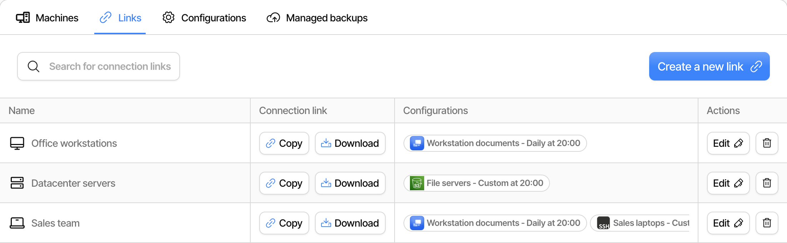
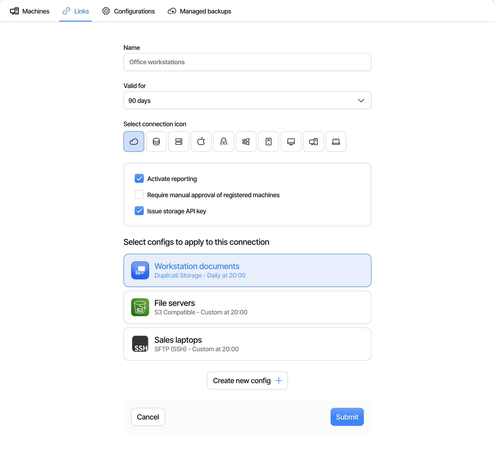

# Connecting to the Duplicati console

The Duplicati open-source client can run without a connection to the console, but connecting the client offers additional features, such as backup monitoring, remote management, zero-configuration storage and more.


Since the [Agent](../duplicati-programs/agent.md) does not have a local UI, refer to the [Agent section for information on how to register](../duplicati-programs/agent.md)


## Connect a single machine

To connect a single machine to the Duplicati console, the simplest approach is to use the dedicated "Click to register" feature shown in the top-right corner of the Duplicati open-source client screen:

<figure><picture><source srcset="../.gitbook/assets/Screenshot 2026-05-28 at 11.40.54.png" media="(prefers-color-scheme: dark)"></picture><figcaption></figcaption></figure>

After clicking "Click to register" you will need to accept adding the machine to your account:

<figure><figcaption></figcaption></figure>

After this, the machine is connected to the console, and no further action is needed.

## Connect with a link


Links are available with a Pro or Enterprise subscription, and during a trial. You must be an owner of the organization to create or change a link.



Registering an [Agent](../duplicati-programs/agent.md) requires an Enterprise subscription or a trial. With a Pro subscription, links can only register the TrayIcon and the Server.


If you prefer a more automated way to connect to the console, you can generate a link that is pre-authenticated. This is done on the ["Links" page on the console](https://app.duplicati.com/app/machines/links):

<figure><picture><source srcset="../.gitbook/assets/console-links-list-dark.png" media="(prefers-color-scheme: dark)"></picture><figcaption></figcaption></figure>

Click "Create a new link" to create the link and set the [options on the link](connecting-to-the-duplicati-console.md#link-options). Then click the "Copy" button to copy the URL. On the open-source client, go to settings and paste in the link into the "Connect to console" field, replacing the existing text:

<figure><picture><source srcset="../.gitbook/assets/Screenshot 2026-05-28 at 11.48.36.png" media="(prefers-color-scheme: dark)"></picture><figcaption></figcaption></figure>

Then click "Register on console" and the open-source client will connect directly.

If you prefer to register via the commandline, you can run either [TrayIcon](../duplicati-programs/trayicon.md) or [Server](../duplicati-programs/server.md) with the `--register-remote-control=<copied-url>`, for example:

```
duplicati-server --register-remote-control=<copied-url>
```

### Link options

The options are set when you create the link, and can be changed later with the "Edit" button:

<figure><picture><source srcset="../.gitbook/assets/console-links-create-dark.png" media="(prefers-color-scheme: dark)"></picture><figcaption></figcaption></figure>

| Option                                         | Description                                                                                                                                                  |
| ---------------------------------------------- | ------------------------------------------------------------------------------------------------------------------------------------------------------------ |
| Name                                           | The name shown in the list of links. This is required.                                                                                                       |
| Valid for                                      | How long the link can be used, from 30 days to 5 years. The default is 90 days. When editing a link, this is instead a "Valid until" date that can be moved. |
| Select connection icon                         | The icon shown next to the link.                                                                                                                             |
| Activate reporting                             | Machines send backup reports to the console. This is on by default.                                                                                          |
| Require manual approval of registered machines | New machines wait until you choose "Approve Machine" in the machine list. Until then, they have no license and receive no configurations.                    |
| Issue storage API key                          | Machines get a key for [Duplicati Storage](duplicati-storage.md). This is on by default.                                                                     |
| Select configs to apply to this connection     | [Backup configurations](backup-configurations.md) that are pushed to machines that register with the link. Requires an Enterprise subscription.              |

If the organization has per-machine storage limits enabled, the link also has the options "Unlimited storage" and "Storage quota".

### Manage links

The options only apply when a machine registers. Changing a link does not change machines that are already registered, and this includes the configurations on the link.

A link that has expired can no longer register machines. The trash can button deletes a link, so it can no longer be used. Machines that have already registered with the link stay connected.

## Connect with a file

Similar to the [link approach](connecting-to-the-duplicati-console.md#connect-with-a-link), you can also generate a file that configures the open-source client to automatically connect. This is done with the "Download" button on the ["Links" page on the console](https://app.duplicati.com/app/machines/links):

<figure><picture><source srcset="../.gitbook/assets/console-links-list-dark.png" media="(prefers-color-scheme: dark)"></picture><figcaption></figcaption></figure>

You will then download a file named [`preload.json`](../detailed-descriptions/configuration-and-management/preload-settings.md) which has the link inside. The same file works for the TrayIcon, the Server and the [Agent](../duplicati-programs/agent.md). You simply place this file in either the installation folder for Duplicati or in the [datafolder](../detailed-descriptions/database-and-storage/the-server-database.md), and the open-source client will automatically connect to the console when it (re-)starts. After starting with the preload file, the file can be deleted, but has no effect if it is left behind.

Note that a `preload.json` placed inside the data folder is only loaded if the folder passes the [permission check](../detailed-descriptions/database-and-storage/the-server-database.md#limited-access-to-the-database-folder).


For automated install, an MDM tool or similar can place the `preload.json` file in the target folder prior to installing Duplicati such that it automatically connects on startup.
