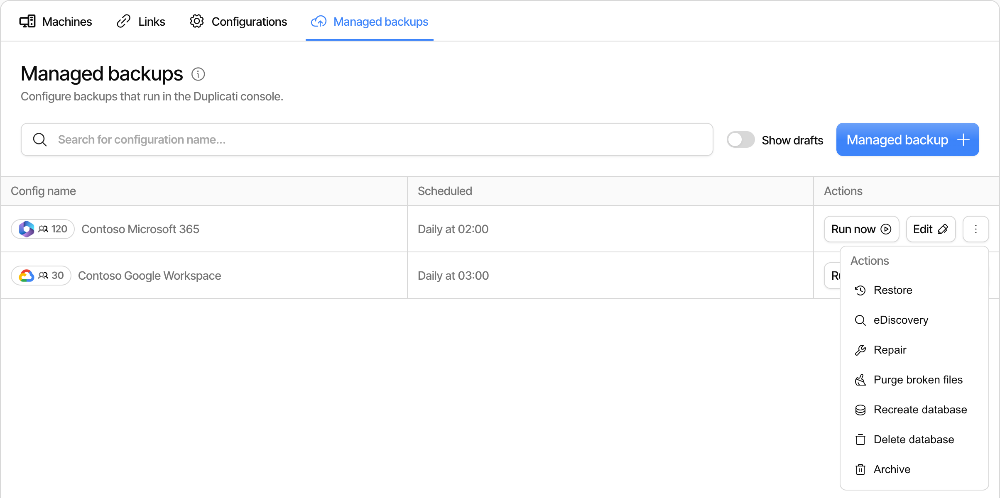
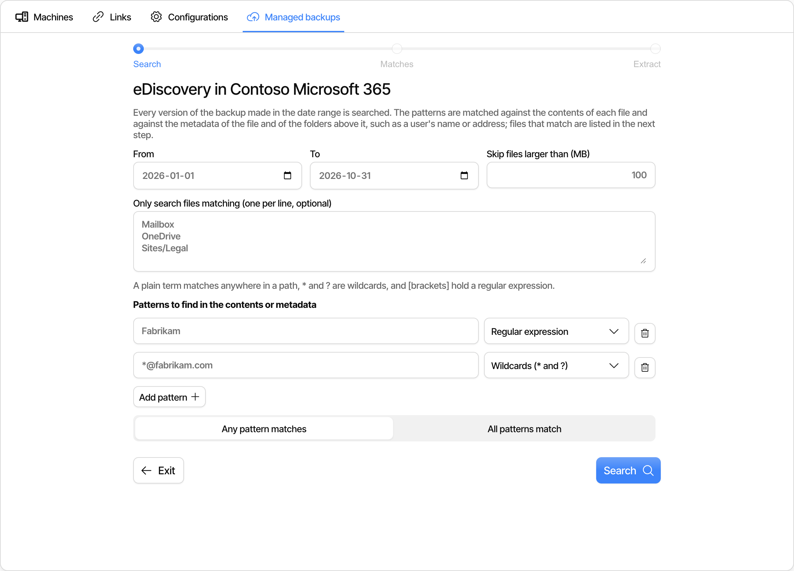
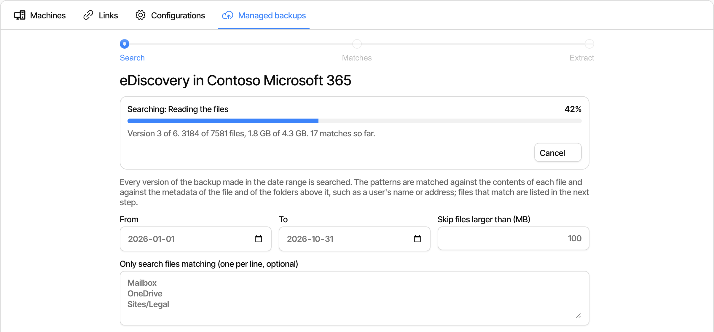
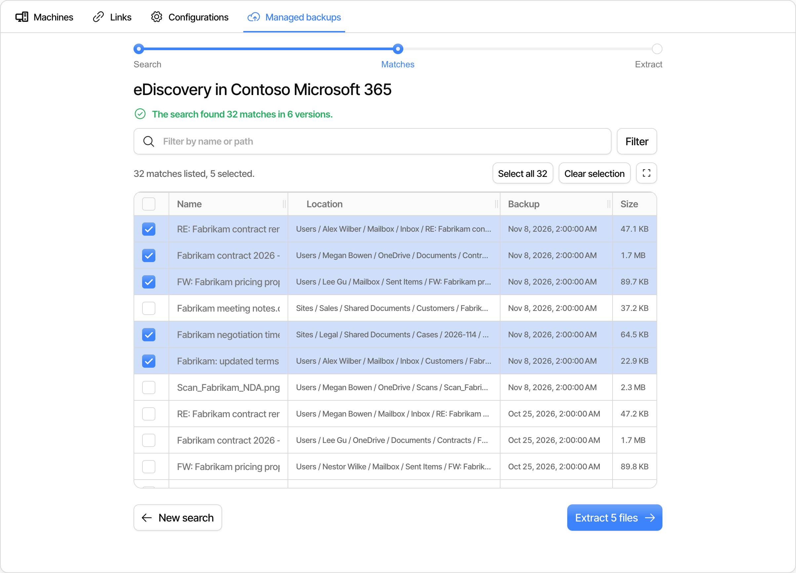
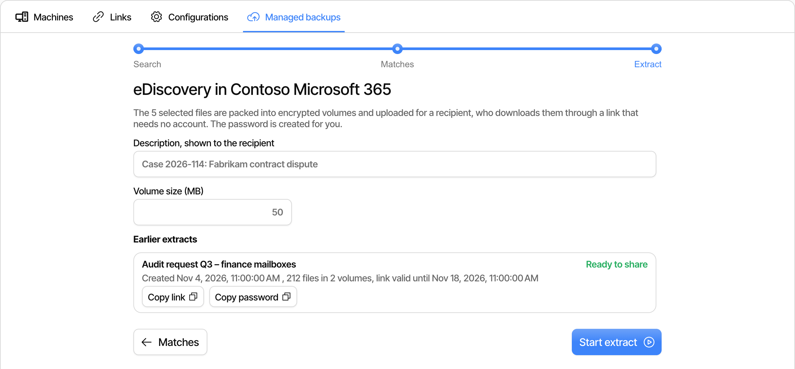
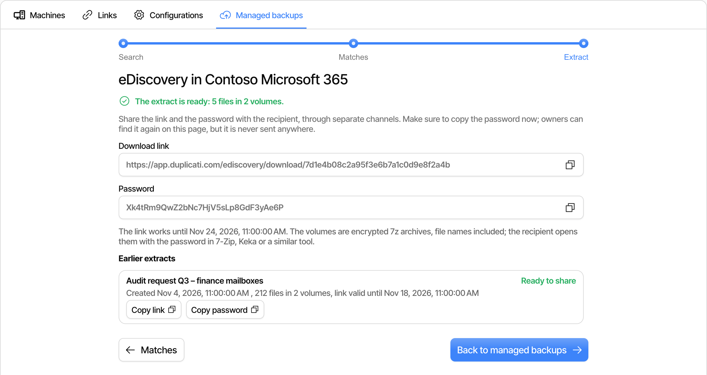
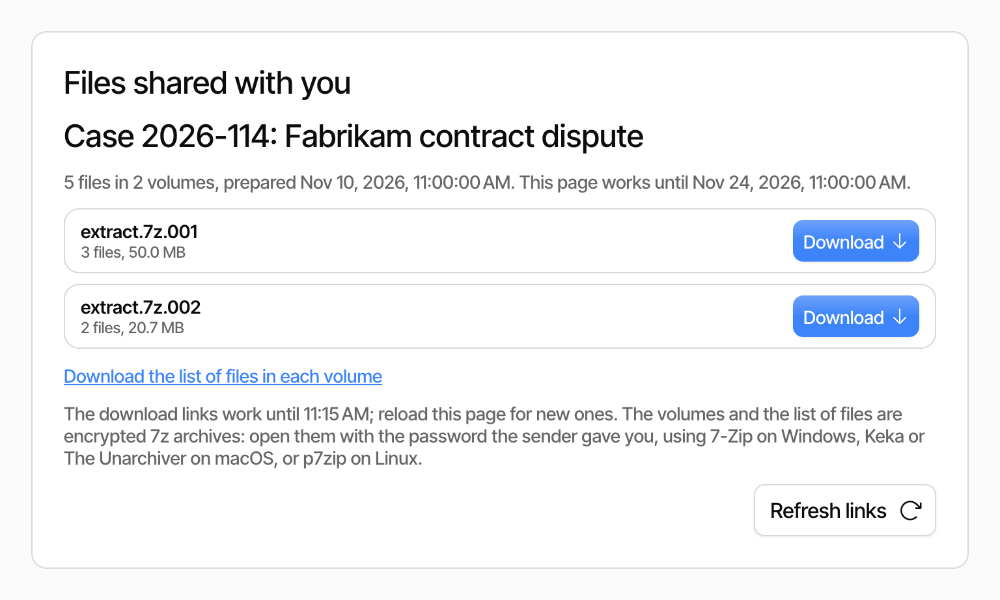

# eDiscovery

eDiscovery searches every version of a [managed backup](managed-backups.md) in a date range for files that contain a pattern, such as a name, an email address or a case number. You pick the files to share from the matches, and the console packs them into encrypted archives that a recipient downloads through a link, without needing an account.

This is useful for legal holds, audits, data subject access requests and other cases where you have to hand over everything a backup holds about a person or a topic, including files and emails that were deleted from the cloud service since the backup was made.

## Requirements

eDiscovery is available for [Microsoft 365](managed-microsoft-365-backup.md) and [Google Workspace](managed-google-workspace-backup.md) managed backups that are not archived. You must be an owner of the organization to search a backup and create extracts.

The search and the extract run on a runner, in the same way as a restore, so the data is decrypted on the runner and never passes through the console. See [How it works](managed-backups.md#how-it-works) for more about runners.

## Start eDiscovery

On the **Managed backups** tab, open the menu of the backup and click **eDiscovery**.

<figure><picture><source srcset="../.gitbook/assets/console-ediscovery-menu-dark.png" media="(prefers-color-scheme: dark)"></picture><figcaption></figcaption></figure>

The console starts a runner for the backup, which usually takes a minute or two. The page shows a countdown while it waits for the runner to connect. The runner stays available for up to 3 hours. If it stops, the page shows that the runner has stopped, and you can click **Start it again**. The matches of the previous search are lost when the runner stops, so the search must be run again.

eDiscovery has three steps: **Search**, **Matches** and **Extract**.

## Search

<figure><picture><source srcset="../.gitbook/assets/console-ediscovery-search-dark.png" media="(prefers-color-scheme: dark)"></picture><figcaption></figcaption></figure>

Fill in what to search for:

* **From** and **To**: The versions of the backup made in this date range are searched. Both dates are included. Leave a field empty to search from the first version, or up to the latest version.
* **Skip files larger than (MB)**: Files above this size are not searched. The default is 100 MB. Raise it if you need to search large files, as larger files make the search slower.
* **Only search files matching**: Optionally limit the search to some files, one filter per line. A plain term matches anywhere in the path, `*` and `?` are wildcards, and a regular expression is written in square brackets, such as `[.*\.pdf$]`. Use it to search only one user, for example, or only some file types.
* **Patterns to find in the contents or metadata**: The text to look for. Each pattern is either a **Regular expression** or uses **Wildcards (\* and ?)**, and matches anywhere in the text. Click **Add pattern** to add more patterns. With more than one pattern, choose **Any pattern matches** to find files that match at least one of them, or **All patterns match** to find files that match all of them.

Click **Search** to start the search.

A pattern is matched against the text of each file, and against the metadata of the file and of the folders above it. The metadata includes the names and email addresses that Microsoft 365 and Google Workspace record for users, mailboxes, sites and drives, so searching for a user's email address finds all of that user's files and emails, as well as files that mention the address.

The text is extracted from documents, PDF files, emails and other common formats. Text in images and scanned documents is recognized with OCR, which works best with English text.

### While the search runs

<figure><picture><source srcset="../.gitbook/assets/console-ediscovery-searching-dark.png" media="(prefers-color-scheme: dark)"></picture><figcaption></figcaption></figure>

The search restores each version in the date range on the runner and searches the files in it. The page shows the version that is being searched, the progress of that version, the number of matches so far, and the latest warnings and errors. A search of many versions or a large backup can take a long time. Click **Cancel** to stop it.

When the search has completed, the console shows the matches.

## Matches

<figure><picture><source srcset="../.gitbook/assets/console-ediscovery-matches-dark.png" media="(prefers-color-scheme: dark)"></picture><figcaption></figcaption></figure>

The list shows every match with its name, its location, the time of the backup version it was found in, and its size. Names and locations are shown the way the cloud service names them, such as the subject of an email and the name of the mailbox and folder it is in, rather than the internal ids that are stored in the backup. A file that matches in more than one version is listed once for each version it was found in.

* Type in the filter field and click **Filter** to show only the matches whose name or location contains the text. The same syntax as the path filters can be used. Click **Clear** to show all matches again.
* Click the **Location** column header to sort the list by location.
* Click a row, or its checkbox, to select it. The checkbox in the header selects all listed matches, and **Select all _N_** selects every match that passes the filter, including the ones that are not loaded yet.
* Click **Load more** at the bottom to load more matches.
* Click the maximize button to show the list in the full window.

Click **Extract _N_ files** to continue with the selected files, or **New search** to change the search. The matches stay on the runner until you start a new search, so you can go back to them after creating an extract.

## Extract

<figure><picture><source srcset="../.gitbook/assets/console-ediscovery-extract-dark.png" media="(prefers-color-scheme: dark)"></picture><figcaption></figcaption></figure>

The selected files are packed into encrypted archives, called volumes, and uploaded so the recipient can download them:

* **Description, shown to the recipient**: What the extract is about, for instance the case or request it was made for. It is shown to the recipient on the download page, and in the list of earlier extracts.
* **Volume size (MB)**: The size each volume is closed at. The default is 50 MB. Use smaller volumes if the recipient has a slow or unstable connection.

Click **Start extract**. The runner restores the selected files and packs them into the volumes, and the page shows the progress.

<figure><picture><source srcset="../.gitbook/assets/console-ediscovery-extract-ready-dark.png" media="(prefers-color-scheme: dark)"></picture><figcaption></figcaption></figure>

When the extract is ready, the page shows a **Download link** and a **Password**. The password is generated by the console. Copy both, and send them to the recipient through separate channels, such as the link in an email and the password in a text message or a phone call. The console does not send them to anyone.

The link works for 14 days. After that, the volumes are deleted.


The volumes are 7z archives encrypted with AES-256, and the file names inside them are encrypted too. Without the password, a person who gets hold of the link can see the description, the number of files and the size of the volumes, but not the content or the file names.


### Earlier extracts

The Extract step lists the earlier extracts of the backup, with their description, status and when they were created. For a completed extract, the list shows the number of files and volumes and how long the link works, and the **Copy link** and **Copy password** buttons copy the link and the password again, for example if the recipient lost them.

## Downloading the files

The recipient opens the link in a browser, and sees a page with the description and a list of the volumes. No account or sign-in is needed.

<figure><picture><source srcset="../.gitbook/assets/console-ediscovery-download-dark.png" media="(prefers-color-scheme: dark)"></picture><figcaption></figcaption></figure>

* Click **Download** next to each volume to download it. The download buttons work for 15 minutes, so a copied download address cannot be used later. Click **Refresh links**, or reload the page, to get new ones.
* Click **Download the list of files in each volume** to get an encrypted list of the files and the volume each one is in.

Open the volumes with the password, using a tool that supports encrypted 7z archives, such as [7-Zip](https://www.7-zip.org/) on Windows, Keka or The Unarchiver on macOS, or p7zip on Linux. Each version that files were taken from has its own folder in the archive.
