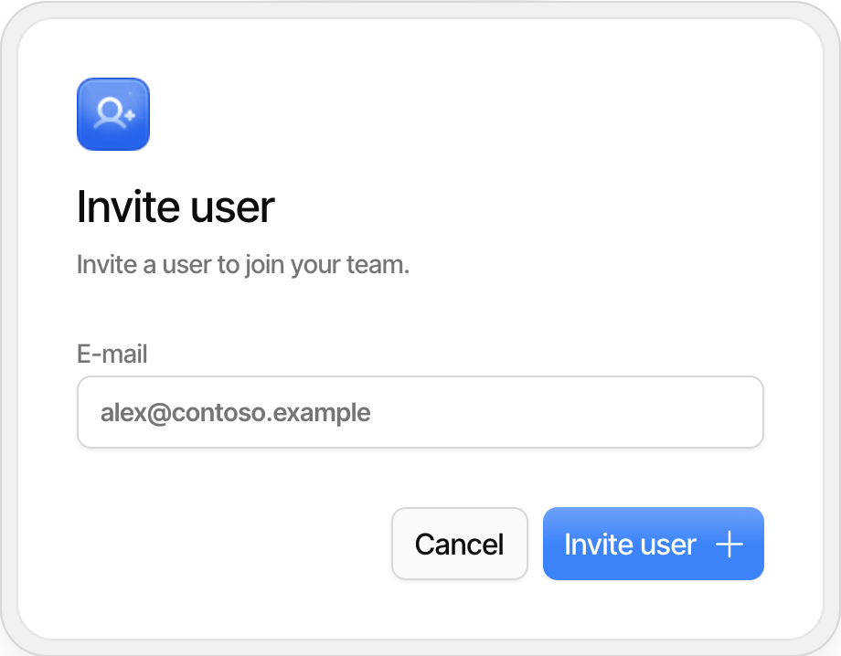
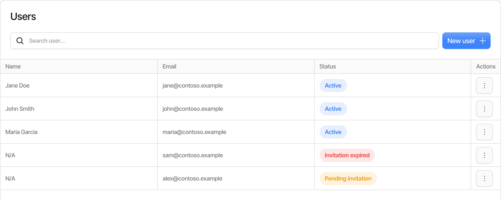
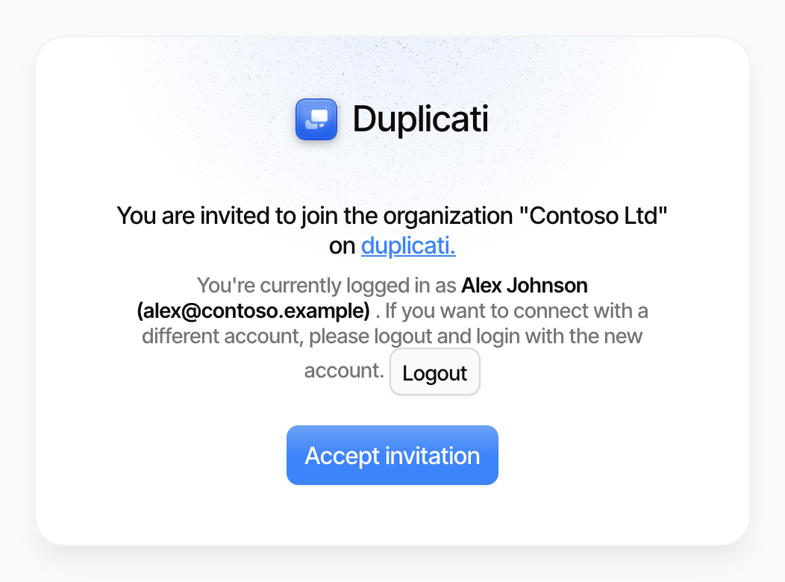
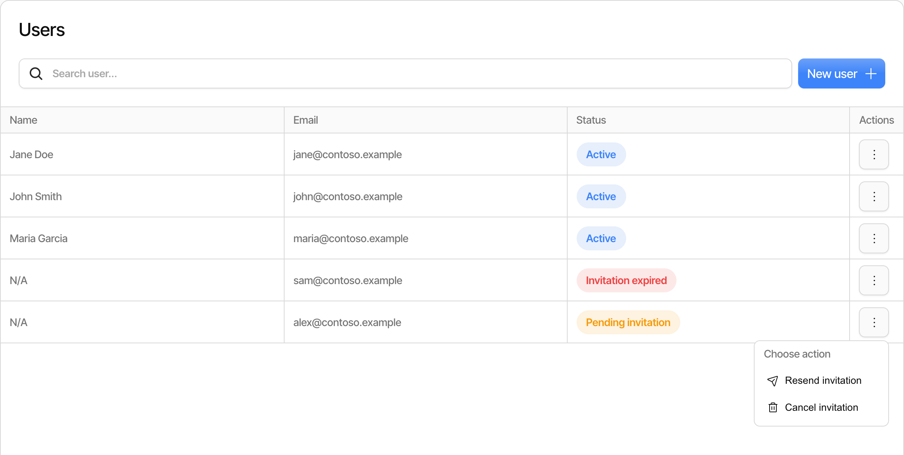

# Inviting users to an organization

You can give other people access to your organization in the Duplicati Console by inviting them by email. The invited person gets an email with a link, signs in to the Duplicati Console, and accepts the invitation to join the organization.


Inviting users requires a Pro or Enterprise subscription, or a running trial. On other subscriptions the **Users** page shows a **Pro feature** label, and clicking **New user** offers an upgrade instead.


## Invite a user

1. Select the organization you want to invite the user to with the organization picker. The invitation is for the organization that is selected when you send it.
2. Click **Users** in the menu on the left.
3. Click **New user**.
4. Enter the email address of the person you want to invite, and click **Invite user**.

<figure><picture><source srcset="../.gitbook/assets/console-users-invite-dialog-dark.png" media="(prefers-color-scheme: dark)"></picture><figcaption></figcaption></figure>

The Duplicati Console sends an email to the address with a link to accept the invitation, and the user is added to the list with the status **Pending invitation**.

<figure><picture><source srcset="../.gitbook/assets/console-users-list-dark.png" media="(prefers-color-scheme: dark)"></picture><figcaption></figcaption></figure>


A user invited from the **Users** page gets the same access to the organization as you have, including the right to invite and remove other users. Only invite people you trust to manage the organization.


The invitation is not sent if:

- The email address belongs to a user who is already in the organization.
- An invitation to the same email address was sent recently. Wait a few minutes and try again. Inviting the same email address again after that sends the existing invitation again, instead of creating a new one.

## Accept an invitation

The invited user does the following:

1. Open the link in the invitation email. The link is valid for 7 days.
2. Sign in to the Duplicati Console, or sign up if you do not have an account yet. You can use any of the available sign-in methods.
3. Check the name of the organization and the account you are signed in with, and click **Accept invitation**.

<figure><picture><source srcset="../.gitbook/assets/console-users-accept-invitation-dark.png" media="(prefers-color-scheme: dark)"></picture><figcaption></figcaption></figure>

The invitation is accepted by the account that is signed in, which does not need to use the same email address the invitation was sent to. If you are signed in with the wrong account, click **Logout**, and sign in with the account that should join the organization. The invitation link is remembered, so you are taken back to the invitation after you sign in.

After you accept the invitation, the organization is available in the organization picker, and the user's status on the **Users** page changes to **Active**.

If the page shows **Invalid invitation link**, the invitation was cancelled or has already been accepted. If the invitation is more than 7 days old, it can no longer be accepted. In both cases, ask the person who invited you to send a new invitation.

## Resend or cancel an invitation

To manage a pending invitation, click the menu button in the **Actions** column for the user.

<figure><picture><source srcset="../.gitbook/assets/console-users-invite-actions-dark.png" media="(prefers-color-scheme: dark)"></picture><figcaption></figcaption></figure>

- **Resend invitation** sends the invitation email again with the same link. You can resend an invitation 5 minutes after it was last sent. Resending does not extend the 7 days the link is valid.
- **Cancel invitation** revokes the invitation, so the link in the email no longer works.

An invitation that was not accepted within 7 days is shown as **Invitation expired** and cannot be resent. Click **New user** to send a new invitation to the same email address, and use **Cancel invitation** to remove the expired invitation from the list.

## Remove a user

To remove a user who has accepted an invitation, click the menu button in the **Actions** column for the user, and click **Remove user from team**. The user loses access to the organization.

See [User management in the Duplicati Console](user-management-in-the-duplicati-console.md) for how security groups and sub-organizations control what users can access.
