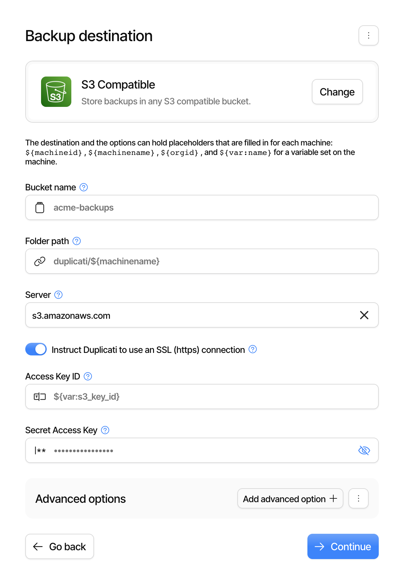
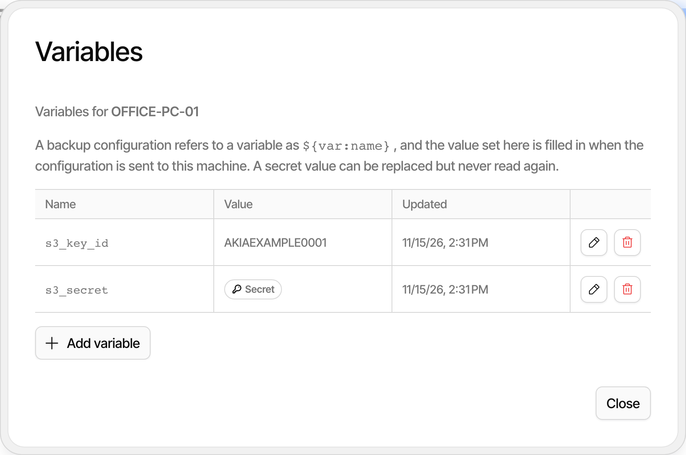
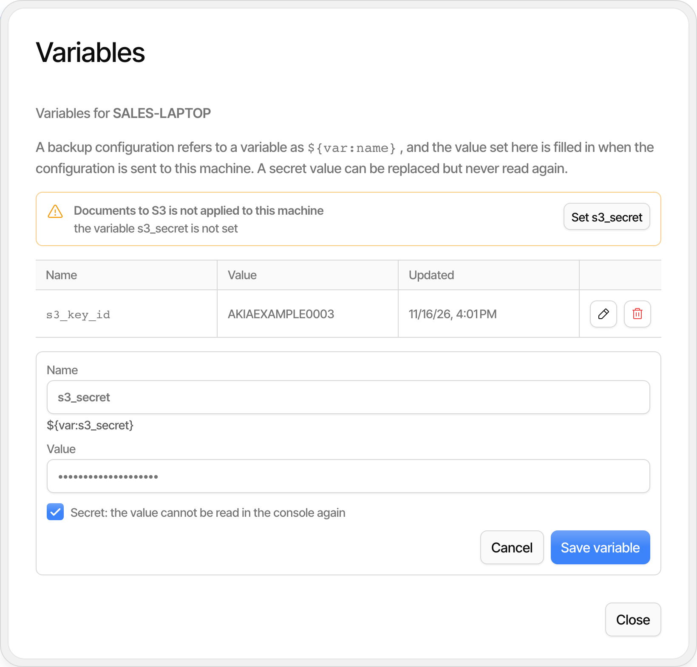
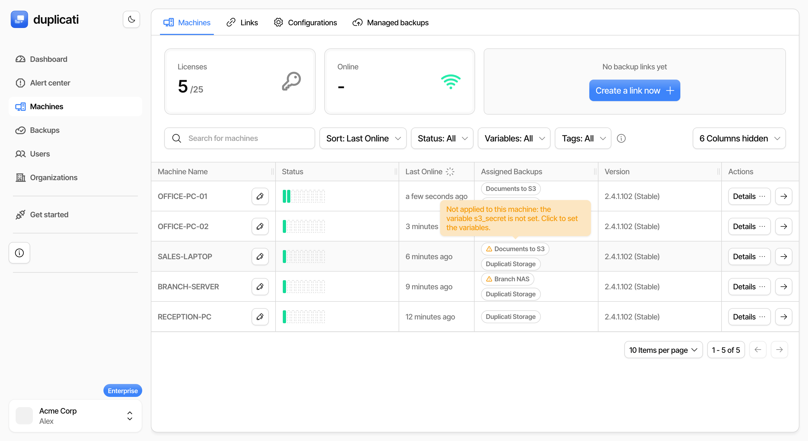
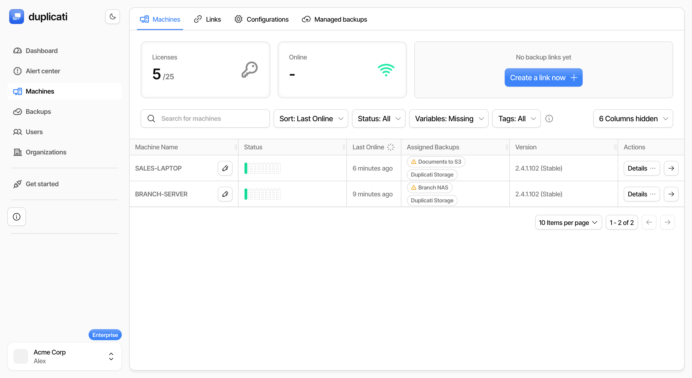
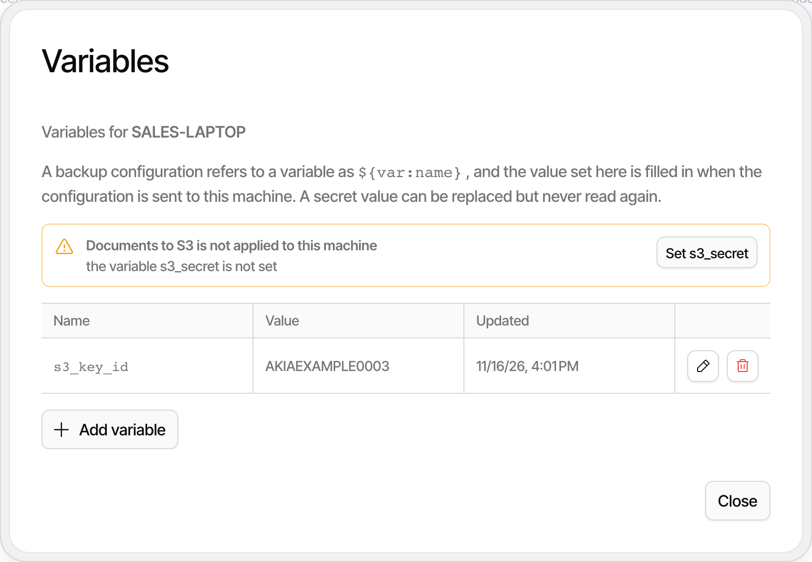
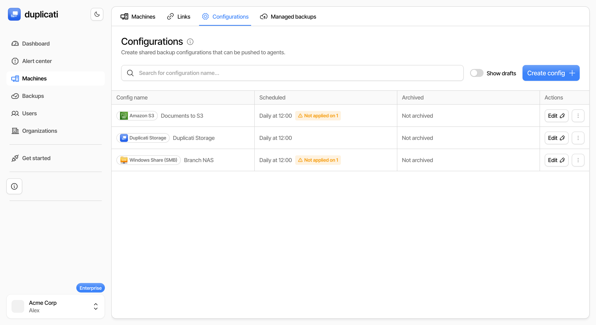

# Machine variables

A machine variable is a named value that belongs to one machine. A [backup configuration](backup-configurations.md) refers to the variable by name, and when the configuration is sent to a machine, the console fills in that machine's value. This means the whole setup can be defined in the console: one shared configuration, and a small set of values on each machine for what is different, such as the credentials for the destination, a folder name or a server address.


Variables are part of backup configurations, so they require an Enterprise subscription and are only available to owners of the organization. They are not available for an organization with [confidential processing](confidential-processing.md).


## How variables work

In a configuration, a variable is written as `${var:name}`, where `name` is the name of the variable. For instance, a configuration that stores the backups in S3 can use a shared bucket and folder, and take the access key from each machine:

| Field         | Value                      |
| ------------- | -------------------------- |
| Bucket name   | `acme-backups`             |
| Folder path   | `duplicati/${machinename}` |
| Access Key ID | `${var:s3_key_id}`         |
| Secret key    | `${var:s3_secret}`         |

Each machine then has the variables `s3_key_id` and `s3_secret` with its own values. The `${machinename}` placeholder is one of the [built-in machine placeholders](backup-configurations.md#machine-placeholders), which are filled in the same way, but do not need to be set.

<figure><picture><source srcset="../.gitbook/assets/console-configurations-destination-variables-dark.png" media="(prefers-color-scheme: dark)"></picture><figcaption></figcaption></figure>

The values are filled in by the console each time it sends the configuration to a machine. The configuration itself keeps the placeholders, so a change to a variable is sent to the machine right away, without changing the configuration.

### Where variables can be used

Variables can be used in the same places as the built-in placeholders:

- The destination, including the server, the folder path, the credentials and the destination options.
- The connection string of a [remote source](../detailed-descriptions/configuration-and-management/remote-sources.md).
- The advanced options.
- The backup name and the description.
- The source paths and the filters.

A value that is filled into the destination or a remote source is URL-encoded by the console, so a value can contain characters such as `/`, `@` or `&` and is still read correctly. A value is inserted as it is, so a value that itself contains a placeholder is not filled in again.


A secret variable can only be used in the destination, a remote source and the values of the advanced options. The backup name, the description, the source paths and the filters are sent back to the console in the backup reports, so a secret used there would be revealed. A configuration that uses a secret variable in such a place is not applied, as described in [When a variable is missing](machine-variables.md#when-a-variable-is-missing).


## Set the variables on a machine

1. Go to the [**Machines** tab](https://app.duplicati.com/app/machines).
2. Open the **Details** menu at the end of the row for the machine and choose **Variables**.

The dialog lists the variables on the machine, with the value and the time it was last changed. Secret variables show **Secret** in place of the value:

<figure><picture><source srcset="../.gitbook/assets/console-machines-variables-dialog-dark.png" media="(prefers-color-scheme: dark)"></picture><figcaption></figcaption></figure>

Click **Add variable**, enter the **Name** and the **Value**, and click **Save variable**. The placeholder to use in the configuration is shown below the name. Check **Secret** for a value that should not be shown in the console again, such as a password or a key:

<figure><picture><source srcset="../.gitbook/assets/console-machines-variables-add-dark.png" media="(prefers-color-scheme: dark)"></picture><figcaption></figcaption></figure>

A variable name starts with a lowercase letter, and holds up to 64 lowercase letters, digits and underscores. The value cannot be empty, and can be up to 4096 characters long.

Use the pen to change a variable, and the bin to delete it. When changing a variable, leave the value empty to keep the current value, for instance to only make a plain variable secret.

### Secret variables

All values are stored encrypted in the console, but the value of a secret variable is never returned to the console after it is saved. It cannot be shown, and it can only be replaced with a new value. A secret variable can only be made a plain variable together with a new value, so the stored value is never revealed.


The value of a variable, secret or not, is sent to the machine as part of the configuration, and is stored in the configuration of the backup on the machine. Secret variables protect the value in the console, not on the machine. To keep a secret out of the console altogether, use a [secret manager on the machines](backup-configurations.md#use-a-secret-manager-on-the-machines) instead.


The variables are deleted together with the machine, so a machine that is deleted and registered again starts without variables.

## When a variable is missing

A configuration that refers to a variable the machine does not have cannot be sent to the machine, as the backup would otherwise use the placeholder text as a folder name or a password. The console holds the configuration back from that machine until the variable is set. The same happens when a secret variable is used in a place where secrets are not allowed.

While a configuration is held back:

- A backup that is already on the machine keeps running with the settings it had, and is not removed.
- A machine that does not have the backup yet, does not get it.
- As soon as the missing variables are set, the configuration is sent to the machine.

This is the normal order of work for a new machine: assign the configuration, or let a [connection link](backup-configurations.md#apply-a-configuration-with-a-connection-link) assign it, and then set the variables.

### Finding machines with missing variables

In the **Assigned Backups** column of the machine list, a configuration that is held back is marked with a warning. Hover the configuration to see which variables are missing, and click it to open the variables of the machine:

<figure><picture><source srcset="../.gitbook/assets/console-machines-variables-list-dark.png" media="(prefers-color-scheme: dark)"></picture><figcaption></figcaption></figure>

The **Variables** menu above the list has the choice **Missing**, which keeps only the machines with a configuration that is held back:

<figure><picture><source srcset="../.gitbook/assets/console-machines-variables-filter-dark.png" media="(prefers-color-scheme: dark)"></picture><figcaption></figcaption></figure>

In the **Variables** dialog of such a machine, each configuration that is held back is listed at the top with the reason. Click **Set** for a missing variable to add it with the name filled in:

<figure><picture><source srcset="../.gitbook/assets/console-machines-variables-not-applied-dark.png" media="(prefers-color-scheme: dark)"></picture><figcaption></figcaption></figure>

On the [**Configurations** tab](https://app.duplicati.com/app/machines/configurations), a configuration that is held back from some machines shows **Not applied on** with the number of machines. Click it to see those machines in the machine list:

<figure><picture><source srcset="../.gitbook/assets/console-configurations-not-applied-dark.png" media="(prefers-color-scheme: dark)"></picture><figcaption></figcaption></figure>

### Warnings before a change

The console warns before a change that would hold a configuration back:

- When you assign a configuration to a machine that lacks a variable it uses, the **Variables** dialog for the machine opens after you click **Save** in **Assign Backups**.
- When you save a configuration with a new variable that some of its machines do not have, the console lists those machines and the missing variables, and asks you to confirm with **Save anyway**.

### Notifications

If a configuration is still held back 15 minutes after it was assigned or changed, the console raises a **Backup Configuration Not Applied** notification for the organization. It names the configuration, the machines and the missing variables, and is shown in the alert center and can be sent to the [notification channels](using-the-duplicati-console.md#notification-channels) of the organization. The notification is sent once for each time a configuration is held back. It is not withdrawn when the variables are set.

## Variables and managed backups

The machine list does not have the **Variables** action for a [managed backup](managed-backups.md) runner, so a managed backup should not use variables. If the configuration of a managed backup refers to a variable that the runner does not have, the run fails with a message that names the missing variables, instead of running with the placeholder.
