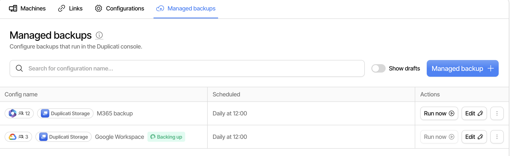

# Managed backups

A managed backup is a backup that the Duplicati Console runs for you. There is no software to install and no machine to maintain: you provide the credentials for the cloud service, and the console runs the backup on a schedule, stores the data and reports the results.

Managed backups are found on the [**Managed backups** tab](https://app.duplicati.com/app/machines/managed-backups) under **Machines**. The console supports two sources, and each has its own guide with the steps for the credentials, the wizard and the restore:

- [Managed Microsoft 365 backup](managed-microsoft-365-backup.md)
- [Managed Google Workspace backup](managed-google-workspace-backup.md)

If you want to back up files on your own machines from the console instead, see [Backup configurations](backup-configurations.md).


Managed backups require **managed backup users** on your subscription. They are purchased separately from machine licenses and do not require an Enterprise plan. Trials do not include managed backup users; contact support if you want to try it. You must be an owner of the organization to create a managed backup, run it, restore from it or do maintenance on it.



Managed backups are not available for organizations with [confidential processing](confidential-processing.md) enabled, and the **Managed backups** tab is hidden for such an organization.


## How it works

Each managed backup is executed by a **runner**, which is a Duplicati instance hosted by Duplicati. The runner is started on demand when there is work to do, and stopped again when the work has completed:

1. When the backup is due, or when you click **Run now**, the console starts a runner for the backup.
2. The runner receives the backup configuration, connects to the cloud service and reads the data.
3. The data is deduplicated, compressed and encrypted, and then uploaded to the storage destination.
4. The runner reports the result to the console and is shut down.

Runners are also started on demand when you browse the source to set up filters, test the permissions or restore data. Starting a runner usually takes a minute or two.

Each managed backup shows up in the [machine list](the-machine-list.md) as a machine named after the backup, followed by "Runner". This machine does not use a machine license and always runs the latest Duplicati release. It is where the backup reports and activity for the managed backup are collected, so the dashboards, reports and alerts work for managed backups as well.

The backup data is encrypted with a passphrase that is generated automatically when the backup is created. The encryption settings cannot be changed afterwards.

## Managed backup users

Managed backups are licensed per **managed backup user**, also referred to as a seat. Seats are purchased on the subscription page under **Settings → Subscription**, and the same seats can be used for either Microsoft 365 or Google Workspace backups.

When you create a managed backup, you assign a number of seats to it. A backup with a given number of seats can back up that many users, that many groups, that many sites and, for Google Workspace, that many shared drives. The number of seats a backup uses is the largest of these counts, not the sum. The exact rules for what counts are on the page for each source.

After each backup, the list shows how many seats are assigned to the backup and how many the latest backup used. The number is highlighted when a backup has no seats assigned.


If the source contains more items than there are seats assigned to the backup, the items beyond the limit are **not backed up** and the backup log contains a warning. Assign enough seats, or use filters to leave out the parts of the source that you do not want to back up. Restores are not limited by seats.


### Usage-based subscriptions

On a usage-based subscription there is no fixed pool of seats to assign. Each backup is instead billed by the number of seats the latest backup used, and the list shows that number. Contact Duplicati if you want a usage-based subscription.

### Storage

Each purchased managed backup user adds **100 GB** of [Duplicati Storage](duplicati-storage.md) to the account. The storage is pooled for the organization, so it does not matter how the data is distributed between the backups. As an example, 25 managed backup users give 2.5 TB of storage that is shared by all backups in the organization.

If the storage quota is exceeded, the console raises a **Storage quota exceeded** alert, and new backups may fail until the usage is brought below the quota again or more storage is added.

You can also store a managed backup in your own storage by checking **Use own storage** when the backup is created. Any [destination](../backup-destinations/destination-overview.md) can be used, except the local file destination, as the runner has no persistent local storage.

## The Managed backups tab

The tab lists the managed backups in the current organization with their source, the assigned seats and the schedule. Use the search field to find a backup by name, and **Show drafts** to include backups that were started in the wizard but not finished.

<figure><picture><source srcset="../.gitbook/assets/console-managed-backups-list-dark.png" media="(prefers-color-scheme: dark)"></picture><figcaption></figcaption></figure>

While a runner is active, the backup shows what it is doing, such as **Backing up** or **Restoring**. A **Browsing** chip means a runner is kept alive for a while so the source can be browsed in the wizard or in the restore flow. Only one operation can run at a time for each backup.

Click **Managed backup** to start the wizard for a new backup. For each backup in the list:

| Action             | Description                                                                                        |
| ------------------ | -------------------------------------------------------------------------------------------------- |
| Run now            | Starts a backup right away instead of waiting for the schedule                                     |
| Edit               | Opens the wizard again to change the name, seats, schedule or filters                              |
| Restore            | Restores data from the backup to the cloud service or to a download                                |
| Repair             | Repairs inconsistencies between the local database and the storage destination                     |
| Purge broken files | Removes files from the backup that can no longer be restored due to missing data. Cannot be undone |
| Recreate database  | Rebuilds the local database from the storage destination. No backups run until it has finished     |
| Delete database    | Deletes the local database. Backups fail until the database is recreated                           |
| Archive            | Removes the managed backup and releases the seats assigned to it                                   |

An archived backup stays in the list with an **Archived** chip, so it can still be restored from, but it no longer runs on a schedule.

The results of each backup are reported to the console in the same way as for regular machines, and can be found in the backup reports for the runner machine. See [Using the Duplicati Console](using-the-duplicati-console.md) for details on reports and alerts.
