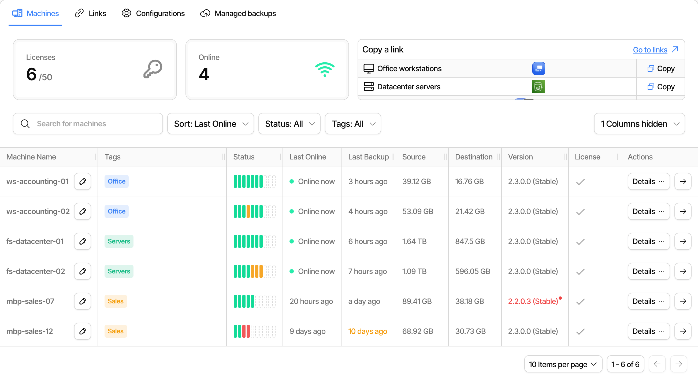

# The machine list

The [**Machines** tab](https://app.duplicati.com/app/machines) lists every machine that is connected to the current organization, with its status, the last backup and the actions that apply to it. This is the starting point for day-to-day management of the connected machines.

The page has four tabs:

- **Machines**, the list described on this page.
- **Links**, where the [connection links](connecting-to-the-duplicati-console.md#connect-with-a-link) for registering new machines are managed.
- **Configurations**, where [backup configurations](backup-configurations.md) are created and pushed to machines. Requires an Enterprise subscription.
- **Managed backups**, where [managed backups](managed-backups.md) of Microsoft 365 and Google Workspace are set up.

The **Configurations** and **Managed backups** tabs are hidden for organizations with [confidential processing](confidential-processing.md).

<figure><picture><source srcset="../.gitbook/assets/console-machines-list-dark.png" media="(prefers-color-scheme: dark)"></picture><figcaption></figcaption></figure>

## Overview cards

At the top of the page, the **Licenses** card shows how many of the machine licenses on the subscription are in use, and the **Online** card shows how many machines are connected right now. If the organization has connection links, the links are listed next to the cards, and clicking a link copies it so it can be pasted into a client.

## The list

Each row is a machine. The columns can be turned on and off with the **Columns** menu, and the selection is remembered in the browser:

| Column            | Description                                                                                                                                                                                                                           |
| ----------------- | ------------------------------------------------------------------------------------------------------------------------------------------------------------------------------------------------------------------------------------- |
| Machine Name      | The name of the machine. Click the pen to rename it in the console. The name on the machine itself is not changed. The machine id is shown when hovering the name.                                                                    |
| Organization      | The organization the machine belongs to. Only useful with **Show all organizations**, and hidden by default.                                                                                                                          |
| Tags              | The [tags](the-machine-list.md#tags) on the machine.                                                                                                                                                                                  |
| Status            | The result of the latest report from each backup on the machine, as colored indicators.                                                                                                                                               |
| Last Online       | "Online now" for a connected machine, otherwise how long ago it was last seen.                                                                                                                                                        |
| Last Backup       | How long ago a backup last completed on the machine. The value is marked when the last backup is more than 7 days old, and marked again when it is more than 30 days old. While a backup is running, a progress bar is shown instead. |
| Last Restore Test | How long ago a [restore test](restore-test-policies.md) last passed, or how many backups on the machine are overdue for one. Hidden by default.                                                                                       |
| Source            | The size of the source data, summed over the backups on the machine.                                                                                                                                                                  |
| Destination       | The size of the data at the destinations, summed over the backups on the machine.                                                                                                                                                     |
| Assigned Backups  | The [backup configurations](backup-configurations.md) that are pushed to the machine. Hidden by default.                                                                                                                              |
| Version           | The Duplicati version and release channel on the machine. The value is marked when a newer version is available. Managed backup runners show "latest".                                                                                |
| License           | Whether the machine has a machine license. Machines with Microsoft 365 or Google Workspace seats show the number of seats as well.                                                                                                    |

The arrow at the end of each row opens the machine, with the backups on it and their reports.

### Finding machines

The search field matches the machine name. The **Sort** menu orders the list by last online, last backup, name, license, or the source or destination size. The **Status** menu keeps only machines where the latest backup report has the chosen result, and the **Tags** menu keeps only machines with one of the chosen tags.

If the organization has sub-organizations, **Show all organizations** adds the machines from the sub-organizations to the list. Actions that need a connection to the machine, such as **Start Session**, are only available for machines in the current organization, so switch to the sub-organization for those.

### Tags

Tags are labels that you define yourself, such as a location, a department or a customer, and they are used to filter the list. Click **Add tags** on a machine, or the tags it already has, to open the tag menu. Check a tag to add it to the machine, and type a name that does not exist yet to create a new tag. The menu next to each tag renames it, changes its color or deletes it from all machines.

Tags belong to the organization, and the same tags are available on every machine in it.

## Machine actions

The **Details** menu at the end of each row holds the actions for the machine. Which actions are shown depends on the state of the machine and the subscription.

### Approving and licensing

A machine needs a machine license to be monitored and to receive configurations. When a machine registers, it normally gets a license right away, as long as there are free licenses on the subscription.

| Action          | Description                                                                                                                                                                                                                     |
| --------------- | ------------------------------------------------------------------------------------------------------------------------------------------------------------------------------------------------------------------------------- |
| Approve Machine | Shown for a machine that registered with a link that [requires manual approval](connecting-to-the-duplicati-console.md#link-options). Gives the machine a license, and the configurations on the link are pushed to it.         |
| Grant License   | Gives a license to a machine that has none, for instance after the license was revoked or when no license was free at the time it registered.                                                                                   |
| Revoke License  | Takes the license away from the machine, so it frees a license for another machine. The machine stays connected and in the list, but is no longer monitored, and the configurations that were pushed to it are removed from it. |
| Delete Machine  | Revokes the license and removes the machine from the console. The machine must be registered again to come back, and the connection must be removed on the machine as well, or it will keep trying to connect.                  |

Deleting a machine does not delete any backups or backup data. The reports that the machine sent are kept in the console.

### Working with the machine

| Action                | Description                                                                                                                                                                                                                                                                                                                                                        |
| --------------------- | ------------------------------------------------------------------------------------------------------------------------------------------------------------------------------------------------------------------------------------------------------------------------------------------------------------------------------------------------------------------ |
| Start Session         | Opens the local Duplicati user interface of the machine in the console, so the machine can be managed as if you were sitting at it. The machine must be online.                                                                                                                                                                                                    |
| Run Restore Test      | Starts a [restore test](restore-test-policies.md) of every backup on the machine. The machine must be online and run Duplicati 2.4.1.0 or newer.                                                                                                                                                                                                                   |
| Assign Backups        | Chooses which [backup configurations](backup-configurations.md) the machine should have. Requires an Enterprise subscription.                                                                                                                                                                                                                                      |
| Assign Cloud Seats    | Issues Microsoft 365 and Google Workspace seats to the machine, so it can run its own [Microsoft 365](../detailed-descriptions/automation-and-integration/office-365-backup-and-restore.md) or [Google Workspace](../detailed-descriptions/automation-and-integration/google-workspace-backup-and-restore.md) backups. Shown when the subscription has such seats. |
| Enable Reporting      | Asks the machine to send its backup reports to the console. **Disable Reporting** stops them again. Reporting is normally turned on by the connection link.                                                                                                                                                                                                        |
| Issue Storage API Key | Gives the machine a key for [Duplicati Storage](duplicati-storage.md). **Rotate Storage API Key** replaces the key, and **Revoke Storage API Key** removes it, so the machine can no longer reach the storage.                                                                                                                                                     |

For a managed backup runner, the only action is **Rotate Storage API Key**, since the runner is managed from the [Managed backups](managed-backups.md) tab.


Backups from a client that is too old to report a machine id are grouped under a machine named **UNKNOWN**. Update the client to have the backups appear under the right machine.

