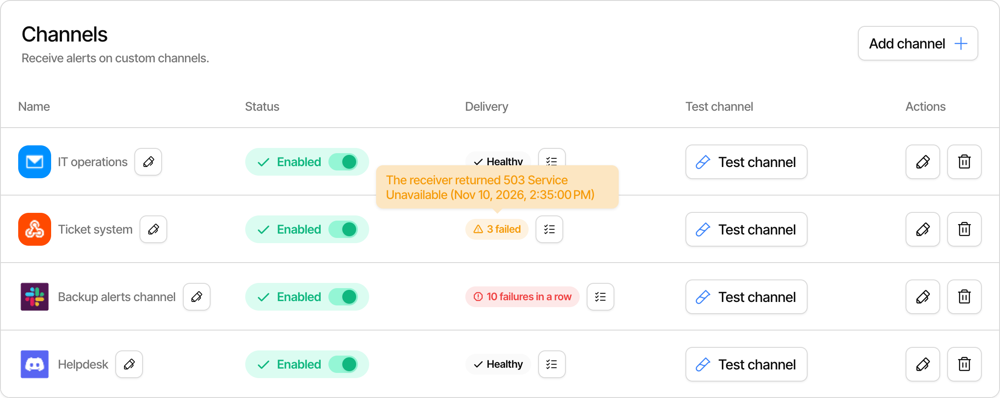
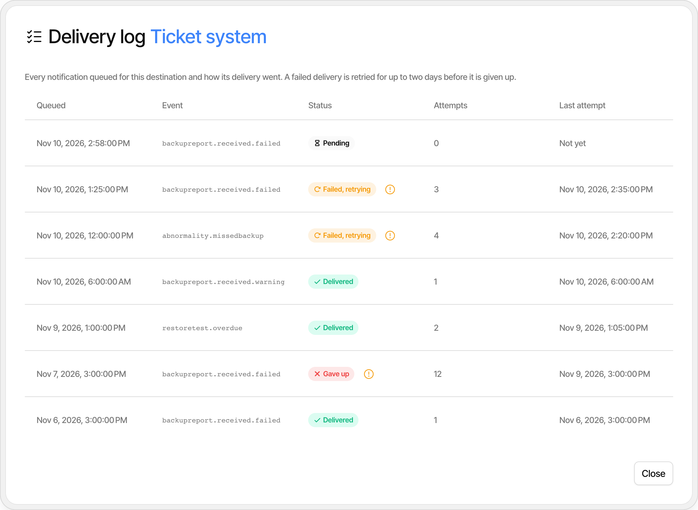
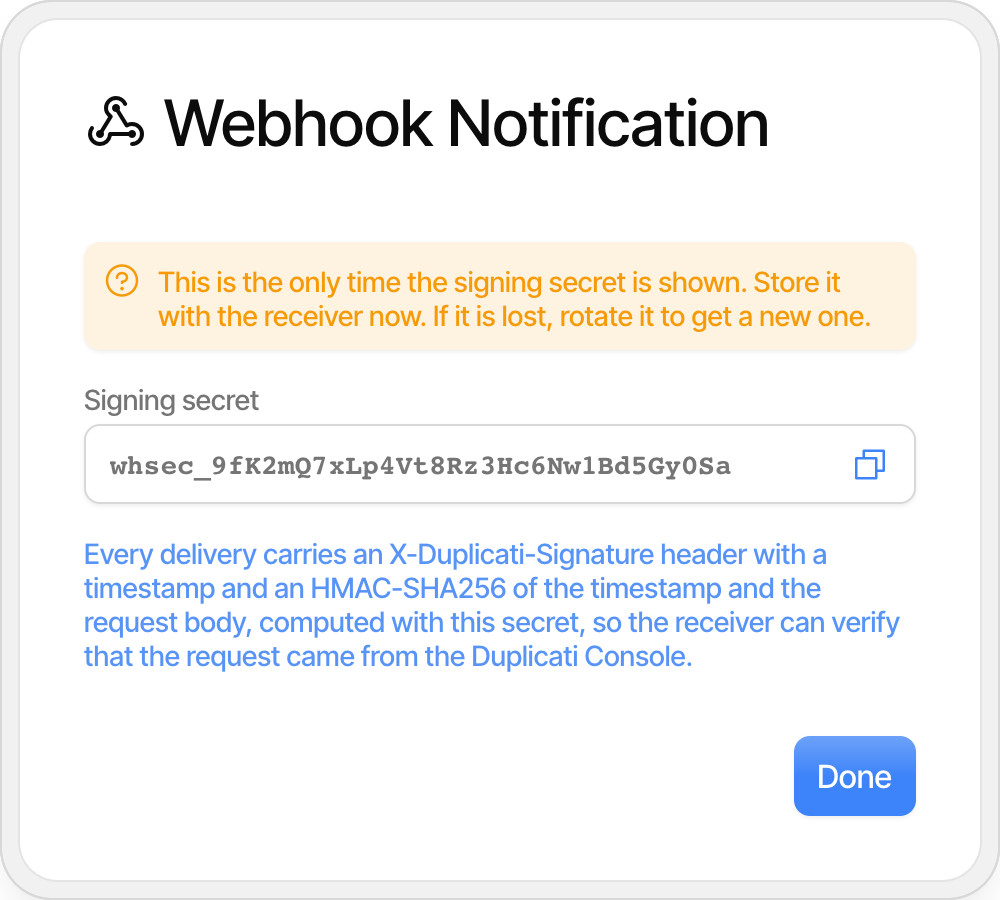
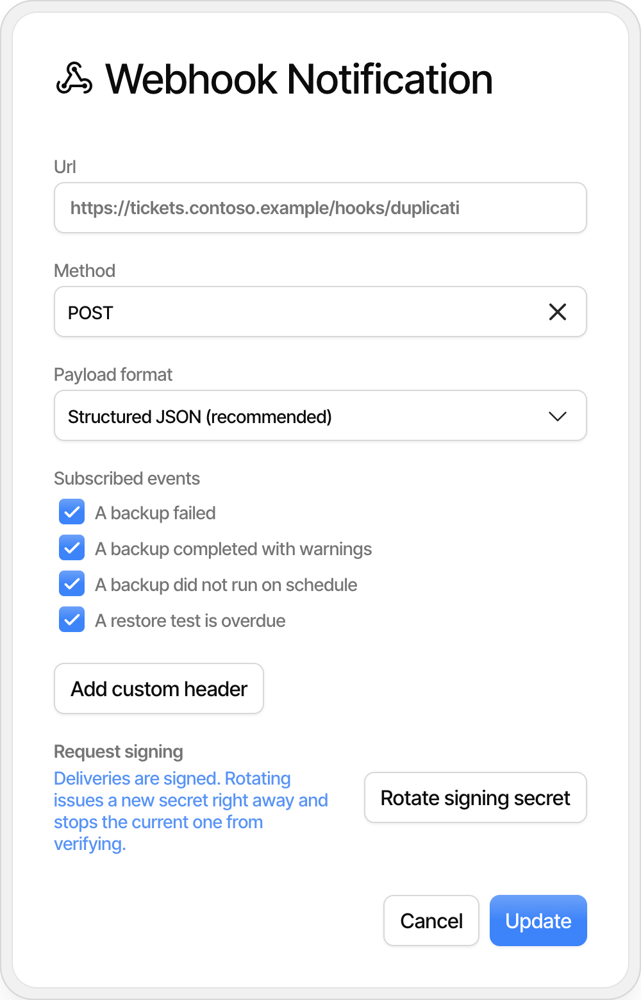
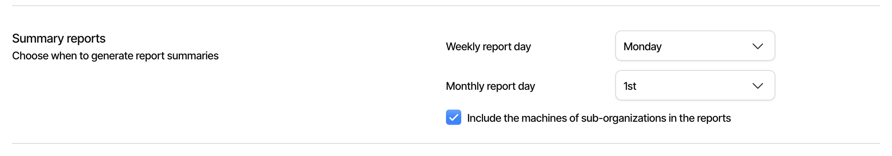
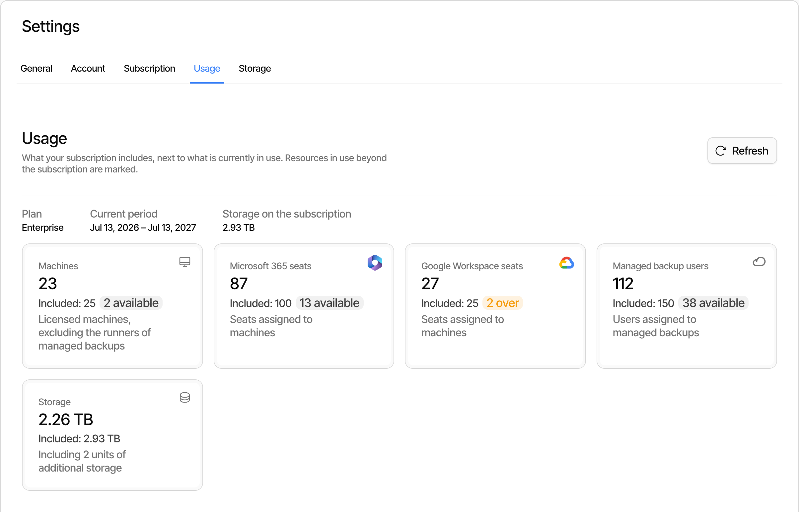

# Using the Duplicati Console

The Duplicati Console is a centralized management interface designed to streamline the monitoring and configuration of backups across multiple machines and organizations. Whether you are managing a handful of devices or hundreds of machines across multiple organizations, the console provides a comprehensive set of tools for ensuring data safety and operational efficiency.


The Duplicati Console is available at [https://app.duplicati.com](https://app.duplicati.com). Some features require an Enterprise or Pro license.


## Free Pro Trial

When you connect your first machine to the Duplicati Console, you automatically receive a **free 30-day Pro trial**. This trial gives you access to advanced features including:

* **Alert Center** – Set up proactive monitoring rules and notifications
* **Advanced Reporting** – Detailed backup reports and analytics
* **AI analysis** - Get an AI expert to analyse your backup results

The trial begins as soon as a machine successfully connects to your console account. No credit card is required to start the trial. After the 30-day period, you can choose to upgrade to a Pro or Enterprise plan to continue using these features, or continue with the limited free tier which includes basic monitoring and management capabilities.

## Getting Started with the Console

### Accessing the Console

Navigate to [https://app.duplicati.com](https://app.duplicati.com) and sign in with your Duplicati account. Once logged in, you will be presented with the main dashboard showing an overview of your organizations and connected machines.

### Connecting Your First Machine

Before you can manage backups through the console, you need to connect machines to your account. There are two primary methods:

1. **Using the TrayIcon or Server** – For existing Duplicati installations, enable remote management from the local settings page. See [Using remote management](/broken/pages/gIhonTRqmXAPnUYwbCol) for detailed instructions.
2. **Using the Agent** – For new installations, deploy the [Duplicati Agent](../duplicati-programs/agent.md) which is designed for headless environments and easier mass deployment. The Agent can be pre-configured with a registration link for seamless onboarding.

## Monitoring at Scale

The Duplicati Console excels at providing visibility across large installations. Instead of checking each machine individually, you can monitor all your backups from a single interface.

### Machine Dashboard

The **Machine Dashboard** serves as your command center for all connected devices:

* **Overview** – View a complete list of all machines associated with your organization, including their current connection status.
* **Status Indicators** – Quickly identify which machines are online, offline, or experiencing issues.
* **Registration Links** – Manage pre-authorized registration tokens for onboarding new machines at scale.
* **Machine Tags** – Apply custom tags to machines for better organization and filtering.

For MSPs and enterprises managing many devices, the ability to see all machines at a glance eliminates the need to log into each device individually. See [The machine list](the-machine-list.md) for the columns, filters and actions on each machine.

### Backup Dashboard

The **Backup Dashboard** provides a centralized view of all backup operations across your entire fleet:

* **Global View** – Monitor backup job statuses across all machines in a single view.
* **Storage Usage** – Track total storage consumption across all backups, helping you plan capacity needs.
* **Visual Status Indicators** – Color-coded indicators show backup results at a glance:
  * **Green (Success)** – Backup completed successfully.
  * **Yellow (Warning)** – Backup completed with warnings that may need attention.
  * **Red (Error/Fatal)** – Backup failed or encountered critical errors requiring immediate action.

### Alert Center (Pro Feature)

The **Alert Center** enables proactive monitoring through customizable rules and multi-channel notifications:

#### Monitoring Rules

Create custom profiles to detect abnormalities before they become problems:

* **Missed Backups** – Alert when a backup hasn't run by an expected time, ensuring no machine falls through the cracks.
* **Modified Files Threshold** – Alert when the number of modified files exceeds a defined threshold, potentially indicating unusual activity.
* **Duration Monitoring** – Track backup duration deviations that might indicate performance issues or network problems.

#### Restore Tests

Use [restore test policies](restore-test-policies.md) to decide how often backups must pass a restore test, and get an alert when a backup falls behind.

#### Notification Channels

Configure multiple channels to receive alerts where your team will see them:

* **Email** – Send alerts to validated email addresses.
* **Discord** – Post alerts to a Discord channel.
* **Slack** – Send notifications to a Slack workspace.
* **Webhooks** – Integrate with custom endpoints or other services for advanced automation.

#### Delivery Status and Delivery Log

The list of notification channels, under **Channels** on the **Settings** tab of the Alert Center, has a **Delivery** column that shows how the latest deliveries to each channel went:

* **Healthy** – The latest delivery to the channel succeeded.
* **_N_ failed** – The latest deliveries failed. Hover over the status to see the last error and when it happened.
* **_N_ failures in a row** – The channel has failed so many times in a row that the console no longer sends new notifications to it.

<figure><picture><source srcset="../.gitbook/assets/console-notifications-delivery-tooltip-dark.png" media="(prefers-color-scheme: dark)"></picture><figcaption></figcaption></figure>

Click the delivery log button next to the status to open the **Delivery log** for the channel. It lists every notification queued for the channel, with the time it was queued, the event, the number of attempts, the time of the last attempt and the status:

* **Pending** – The notification is queued and has not been tried yet.
* **Delivered** – The receiving service accepted the notification.
* **Failed, retrying** – The last attempt failed and another attempt is scheduled. Hover over the warning icon to see the error.
* **Gave up** – All attempts failed. A failed delivery is retried for up to two days before the console gives up.

<figure><picture><source srcset="../.gitbook/assets/console-notifications-delivery-log-dark.png" media="(prefers-color-scheme: dark)"></picture><figcaption></figcaption></figure>

When 10 deliveries to a channel fail in a row, the console stops sending new notifications to it and sends the owners of the organization one email saying that the channel is failing, with the last error. The notifications that are already queued are still retried. Delivery resumes when a retry succeeds, or when the channel is tested or edited and saved, so after fixing the address, channel or URL, use **Test** to check it and resume delivery.

#### Webhook Signing Secrets

Requests from a webhook channel are signed, so the receiver can verify that they come from the Duplicati Console. When you add a webhook, the console generates a signing secret and shows it once, after you save. Copy it and store it with the receiver before clicking **Done**, as it cannot be shown again.

<figure><picture><source srcset="../.gitbook/assets/console-notifications-webhook-secret-dark.png" media="(prefers-color-scheme: dark)"></picture><figcaption></figcaption></figure>

Each signed request carries these headers:

| Header                  | Content                                                                                       |
| ----------------------- | --------------------------------------------------------------------------------------------- |
| `X-Duplicati-Signature` | `t=<timestamp>,v1=<signature>`, where the timestamp is in Unix seconds                         |
| `X-Duplicati-Event`     | The event the notification is about, such as `backupreport.received.failed`                        |
| `X-Duplicati-Delivery`  | An id that is unique to the delivery and the same on every retry, so retries can be detected |

The signature is the lowercase hex HMAC-SHA256 of `<timestamp>.<request body>`, with the signing secret as the key. To verify a request, compute the same value from the timestamp in the header and the raw request body, compare it with the signature, and reject requests where the timestamp is too far from the current time, such as more than 5 minutes, so a captured request cannot be replayed later.

To replace the secret, edit the webhook and click **Rotate signing secret**. The new secret is shown once, and the old secret stops working right away, so update the receiver at the same time. Webhooks that were created before signing was introduced are not signed. Edit the webhook and click **Generate signing secret** to start signing its requests.

<figure><picture><source srcset="../.gitbook/assets/console-notifications-webhook-edit-dark.png" media="(prefers-color-scheme: dark)"></picture><figcaption></figcaption></figure>

## Managing Backups Centrally (Enterprise feature)

The console allows you to create backup configurations and push them to multiple machines, ensuring consistency across your organization:

* **Source** – Paths, filters and exclusions for hidden, system and temporary files or files above a given size.
* **Destination** – The same storage providers as the client.
* **Schedule and retention** – When the backup runs and how long the versions are kept.
* **Encryption** – A generated key, or a key stored in the console.

A configuration is assigned to a connected machine, or added to a connection link so machines receive it when they register. When a configuration changes, the assigned machines are updated, so all machines follow the same backup policy without manual configuration on each device.

See [Backup configurations](backup-configurations.md) for how to set this up.

### Managed Backups

The console can also run backups of Microsoft 365 and Google Workspace for you, without a machine of your own. These [managed backups](managed-backups.md) are licensed per managed backup user and do not require an Enterprise plan.

### Confidential Processing

For organizations that handle confidential or protected information, [confidential processing](confidential-processing.md) limits what the console stores: machines send reduced reports, and configurations, managed backups and AI summaries are turned off.

## Organization Management (Enterprise feature)

For MSPs and large enterprises, the console provides powerful multi-organization capabilities:

### Multi-Organization Support

* **Organization Hierarchy** – Create and manage multiple organizations from a single account, with support for up to three levels of hierarchy.
* **Context Switching** – Seamlessly toggle between different organizations to manage their respective resources.
* **Tenant Isolation** – Each organization is isolated, ensuring data and access boundaries between customers or departments.

See [Organization management](organizations-and-sub-organizations.md) for detailed information on setting up hierarchies.

### Summary Reports for Sub-Organizations

The weekly and monthly summary reports are set up under **Settings** → **General** → **Summary reports**, by choosing the **Weekly report day** and the **Monthly report day**. By default, the reports of an organization cover only the machines of that organization.

When the organization has sub-organizations, check **Include the machines of sub-organizations in the reports** to have the reports cover the machines of all organizations below it as well. The report then groups its findings by organization, and the subject of the email names the number of sub-organizations that are included. Sub-organizations that use [confidential processing](confidential-processing.md) are always left out of the reports.

<figure><picture><source srcset="../.gitbook/assets/console-settings-summary-reports-dark.png" media="(prefers-color-scheme: dark)"></picture><figcaption></figcaption></figure>

### Subscription Usage

The subscription covers the root organization and all organizations below it. On the root organization, **Settings** → **Usage** shows the plan, the current subscription period and the resources in use across the whole hierarchy: licensed machines, Microsoft 365 and Google Workspace seats, managed backup users and storage. Click **Refresh** to update the numbers.

* On a **fixed subscription**, each resource is shown next to what the subscription includes, with the amount that is still available or the amount that is over the subscription.
* On a **usage-based subscription**, the usage is reported for billing once a day, so the numbers are what you are billed for if nothing changes before the next report. Every machine and every managed backup user includes an amount of storage, which the page shows.

<figure><picture><source srcset="../.gitbook/assets/console-settings-usage-dark.png" media="(prefers-color-scheme: dark)"></picture><figcaption></figcaption></figure>

### User and Team Management

* **User Invitation** – Invite new members to your organization via email. See [Inviting users to an organization](inviting-users-to-an-organization.md).
* **Teams** – Group users into teams for easier permission management.
* **Access Control** – Granularly assign access rights to specific machines or backup sets for different teams.

See [User management in the Duplicati Console](user-management-in-the-duplicati-console.md) for more details.

## Machine Management at Scale

### Claiming Machines

Securely add new machines to your organization using unique registration tokens. This process ensures that only authorized machines can connect to your console.

### Registration Links

Generate pre-configured links to easily onboard clients or new devices:

* **Pre-authorized URLs** – Create links that allow machines to register automatically, with optional manual approval of each machine.
* **Mass Deployment** – Use registration links with deployment tools or preload configurations for unattended installations.
* **Backup Configurations** – Add [backup configurations](backup-configurations.md) to a link so machines receive them when they register.
* **Security** – Links expire, and can be deleted at any time to prevent unauthorized registrations.

See [Connecting to the Duplicati console](connecting-to-the-duplicati-console.md#connect-with-a-link) for the options on a link.

### Remote Access

Once a machine is connected, you can access its local Duplicati interface directly from the console:

1. Navigate to **Machines**.
2. Find the machine you want to access. The machine must be online.
3. Open the **Details** menu at the end of the row and click **Start Session** to open the machine's local interface.

See [The machine list](the-machine-list.md) for the other actions on a machine.

This eliminates the need for VPNs or remote desktop connections to manage individual machines.

## Best Practices for Large Installations

### 1. Organize with Tags

Apply meaningful tags to machines (e.g., by location, department, or customer) to make filtering and management easier.

### 2. Use Configuration Templates

Create standardized backup configurations for different use cases (e.g., "Workstation Backup", "Server Backup") and apply them consistently.

### 3. Set Up Proactive Monitoring

Configure Alert Center rules to catch issues early:

* Set up missed backup alerts for critical machines.
* Monitor for unusual file modification patterns.
* Track backup duration trends to identify performance degradation.

### 4. Leverage the Organization Hierarchy

For MSPs, use the three-level hierarchy to model your customer structure:

* Root organization for MSP staff
* Sub-organizations for each customer
* Further sub-organizations for customer departments or sites

### 5. Automate Onboarding

Use the Client or Agent with pre-authorized registration links and [preload configurations](../detailed-descriptions/configuration-and-management/preload-settings.md) for seamless mass deployment. The `preload.json` file can be downloaded directly from the Links page in the console and should be placed into the installation folder. When the Agent starts, it will automatically register with the console and any configured backups will be pushed to the agent.

## Summary

The Duplicati Console transforms backup management from a machine-by-machine task into a centralized, scalable operation. By providing a unified view of all backups, proactive monitoring capabilities, and powerful organizational tools, the console makes it easy to manage and monitor large installations while maintaining security and compliance.

Whether you are an MSP managing hundreds of customer devices or an enterprise IT team overseeing a distributed workforce, the Duplicati Console provides the visibility and control needed to ensure your data protection strategy succeeds.
