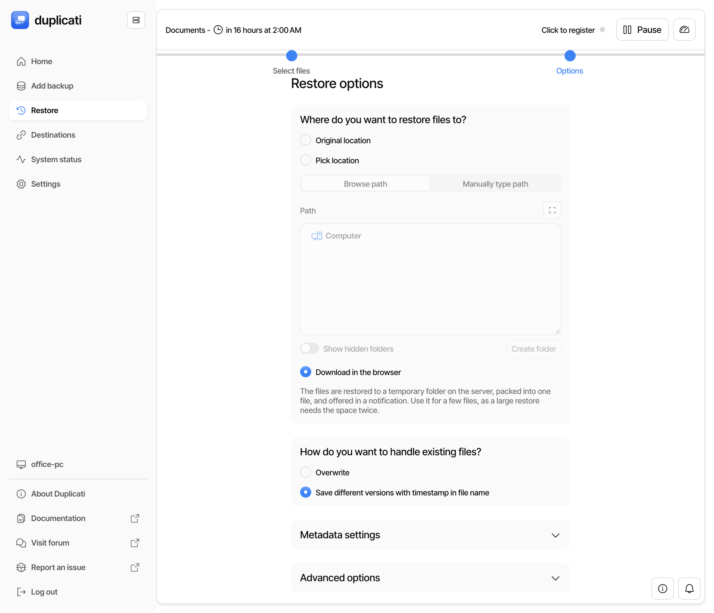
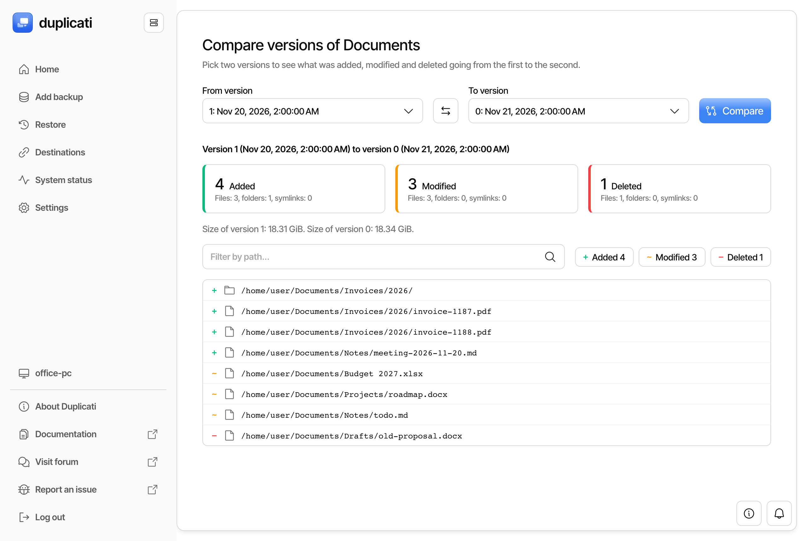

# Restoring files

The most important reason to make a backup is the ability to recover the data at a later stage, usually due to some unforeseen incident. Depending on the incident, the original configuration may not be available.

To start a restore process in Duplicati, start on the "Restore" page.

<figure><picture><source srcset="../.gitbook/assets/Screenshot 2025-11-03 at 13.39.31.png" media="(prefers-color-scheme: dark)"></picture><figcaption>
Choosing a restore approach
</figcaption></figure>

If the backup configuration is already existing on the machine, you can choose it from the list. In this case you can click "Restore" and skip to the section on [choosing the files to restore](restoring-files.md#choosing-files-to-restore).

The restore and browsing process are fastest when using a configured backup, because Duplicati can query a local database with information. If the local database is not present, Duplicati needs to fetch enough information from the remote storage to build a partial database when performing the restore.

If you have exported the backup configuration and have the configuration available, you can click the "Start" button on "Restore from configuration" and skip to the [restore from configuration section](restoring-files.md#restore-from-configuration). You can also read up on how to [import and export configurations](../detailed-descriptions/configuration-and-management/import-and-export-backup-configurations.md).

## Direct restore from backup files

To restore files from the backup, Duplicati needs only to know how to access the files and the encryption passphrase (if any). If you do not have the passphrase, it is not possible to restore.


This option is useful restoring from another machine than the one that made the backup originally, but is not recommended for regular operations due to the need to download and process more data.


To restore directly from the backup files, the first step is to provide the destination details. These details are the same as you supplied initially when creating the backup. If you are using a cloud provider, you can usually get the needed information via your account on the vendors website. You can see a list of the [destinations that are supported by Duplicati](../backup-destinations/destination-overview.md).

<figure><picture><source srcset="../.gitbook/assets/Screenshot 2025-11-03 at 13.44.55.png" media="(prefers-color-scheme: dark)"></picture><figcaption>
Supply storage destination details
</figcaption></figure>

Once the details are entered, it is recommended to use the "Test now" button to ensure that the connection is working correctly. Then click the "Continue" button.

<figure><picture><source srcset="../.gitbook/assets/Screenshot 2025-11-03 at 13.49.24.png" media="(prefers-color-scheme: dark)"></picture><figcaption>
Supply the encryption passphrase
</figcaption></figure>

If the backup is not encrypted, leave the field empty. When ready, click "Continue" and Duplicati will examine the remote destination and figure out what backups are present. After working through the information, you can [choose files to restore](restoring-files.md#choosing-files-to-restore).

From canary 2.4.1.103, a direct restore that was left before it was finished can be continued. As long as the server still has it, the "Restore" page lists it under "Or continue a direct restore". Click "Continue" to pick up where you left, or the dismiss button to remove it from the list.

## Restore from configuration

If you have a configuration file you can use the information in that file to avoid entering it manually. If you need to restore more than once, it may be faster to [import the configuration](../detailed-descriptions/configuration-and-management/import-and-export-backup-configurations.md) and [rebuild the local database](../detailed-descriptions/database-and-storage/the-local-database.md). After the database is built, you can choose the configuration from the list and skip to [choosing files to restore](restoring-files.md#choosing-files-to-restore).

<figure><picture><source srcset="../.gitbook/assets/Screenshot 2025-11-03 at 13.51.29.png" media="(prefers-color-scheme: dark)"></picture><figcaption>
Restoring with a backup configuration
</figcaption></figure>

In the dialog, provide the exported configuration file. If the file is encrypted, you will be asked to enter the file passphrase.


The passphrase the configuration file is encrypted with is not necessarily the same as the passphrase used to encrypt the backup with.


Once the configuration is correct, click the "Restore" button and you will be ready to choose files to restore.

## Choosing files to restore

Once Duplicati has a connection to the remote destination it will find all the backups that were made. It will then choose the most recent version and list the files from within that version. Use the dropdown to select the version to restore from, and then choose the files that you want to restore.

<figure><picture><source srcset="../.gitbook/assets/Screenshot 2025-11-03 at 13.52.05.png" media="(prefers-color-scheme: dark)"></picture><figcaption>
Choosing files to restore
</figcaption></figure>

Click the files or folders that you want to restore and then click "Continue".

From canary 2.4.1.103 and stable 2.4.1.1, the version list shows the number of files in each version. Files that were added to the backup one by one, rather than as part of a folder, are grouped together in the tree, so they are easy to find.

To find a file without browsing the folders, enter part of its name in the search field and click "Search". By default, only the selected version is searched. Check "Search all versions" to search every version of the backup at once; each match is then listed with the version and time it is found in, which helps you find the version to restore from when you do not know when a file was changed or deleted.

## Choosing restore options

When restoring there are a few options that control how the files are restored.

<figure><picture><source srcset="../.gitbook/assets/Screenshot 2025-11-03 at 13.53.03.png" media="(prefers-color-scheme: dark)"></picture><figcaption>
Choosing restore options
</figcaption></figure>

If you want to restore a file to a previous state, you can leave the settings to their defaults. If you are unsure if you want to revert, or need to examine the files before replacing the current versions, you can choose to restore to another destination. If the folder you are restoring to is not empty, you can choose to store multiple versions of the files by appending the restore timestamp to the filename. This is especially useful if you are restoring multiple versions into a target folder for comparison.

### Downloading the restored files in the browser

From canary 2.4.1.103, the files can also be downloaded in the browser instead of being written to a folder on the machine. Choose "Download in the browser" as the restore location. The files are restored to a temporary folder on the server, and offered as a download in a notification when the restore is done. A single file is downloaded as it is, and several files as a zip file. The download is kept on the server for a day.

<figure><picture><source srcset="../.gitbook/assets/ngclient-restore-download-dark.png" media="(prefers-color-scheme: dark)"></picture><figcaption>
Restoring files as a download in the browser
</figcaption></figure>

This is useful when the browser runs on another machine than the Duplicati server. Use it for a few files, as the restored data needs space on the server twice: once for the files and once for the packed file. The option can be turned off for a server with `--webservice-disable-restore-download`.

### Other restore options

Duplicati will not restore permissions by default because the users and groups that were present on the machine that made the backup may not be present on the machine being restored to. Restoring the permissions can cause you to be unable to access the restored files, if your user does not have the necessary permissions.

When satisfied with the settings, click the "Submit" button and the restore process will restore the files.

Once the restore has completed, you will see the restore summary page:

<figure><picture><source srcset="../.gitbook/assets/Screenshot 2025-11-03 at 13.53.52.png" media="(prefers-color-scheme: dark)"></picture><figcaption></figcaption></figure>

To restore only files that changed recently, add the advanced option `--restore-files-modified-after`, with a date such as `2026-01-01` or an interval back from now such as `1M`. For a restore of millions of files, `--restore-temp-tables-on-disk` keeps the lists of files and blocks to restore on disk instead of in memory. See [restore in the command line interface](../duplicati-programs/command-line-interface-cli.md#restore).

## Comparing versions

From canary 2.4.1.103 and stable 2.4.1.1, two versions of a backup can be compared, to see what was added, modified and deleted between them. This helps to find the version to restore from. Click "More actions" on the backup on the home page, and choose "Compare versions". Pick the "From version" and the "To version", and click "Compare".

<figure><picture><source srcset="../.gitbook/assets/ngclient-compare-versions-dark.png" media="(prefers-color-scheme: dark)"></picture><figcaption>
Comparing two versions of a backup
</figcaption></figure>

The result shows the number of added, modified and deleted files, folders and symbolic links, the size of each version, and a list of the changes that can be filtered.

The log of a backup also has a "Compare with previous version" button on each backup run, which compares the version the run made with the version before it.
