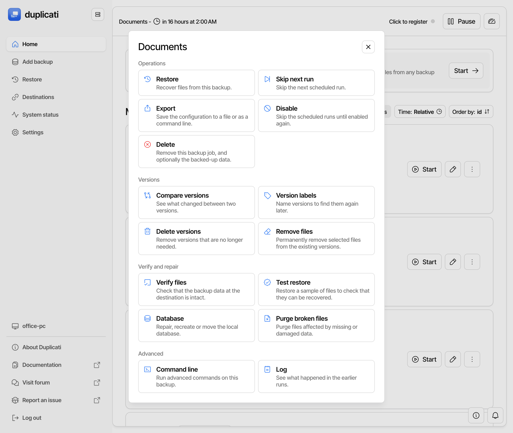

# Running a backup

With a configured backup, you can have a schedule that runs the backup automatically each day. Having the backup run automatically is recommended because it makes it less likely that the backups are not recent if they are needed.

Even if the backup already has a schedule there may be times where you want to manually run a backup. If you have just configured a backup, you may want to run it ahead of the scheduled next run. If you are within the UI you can click the "Start" button for the backup.

<figure><picture><source srcset="../.gitbook/assets/Screenshot 2025-11-03 at 13.35.23.png" media="(prefers-color-scheme: dark)"></picture><figcaption>
A newly configured backup
</figcaption></figure>

Once the backup is running, the top area will act as a progress bar that shows how the backup progresses. Note that the first run of a backup is the slowest run because it needs to process every file and folder that is part of the source. On later runs it will recognize what parts have changed and only process the new and changed data. If the backup compacts the destination after the backup, the progress of the compact is shown as well, so a long compact no longer looks like the backup has stalled.

If you need to automate starting a backup without using the UI, you can use [ServerUtil](../duplicati-programs/command-line-interface-cli-1/serverutil.md) to trigger backups from the commandline.

After running a backup, the view will change slightly and show some information about the backup.

<figure><picture><source srcset="../.gitbook/assets/Screenshot 2025-11-03 at 13.37.25.png" media="(prefers-color-scheme: dark)"></picture><figcaption>
After the backup has completed it shows backup details
</figcaption></figure>

## Disabling a backup

From canary 2.4.1.101, a backup can be disabled without deleting it or its schedule. Click "More actions" on the backup on the home page and choose "Disable" in the dialog that opens. A disabled backup is shown as "Disabled" and skips its scheduled runs, but it can still be started manually. Choose "Enable" in the same dialog to turn the schedule back on.

To skip only the next scheduled run, choose "Skip next run" instead.


The enabled flag is stored in a new column in the [server database](../detailed-descriptions/database-and-storage/the-server-database.md). To go back to an earlier version, the server database must first be downgraded with the [DatabaseTool](../duplicati-programs/command-line-interface-cli-1/databasetool.md).


## Starting all backups and running backups in order

From canary 2.4.1.103, the home page has a "Start all" button that queues all enabled backups, with an option to shut down or restart the computer when they are done. A backup can also be set to run after another backup. See [Scheduling and running backups in order](../detailed-descriptions/configuration-and-management/scheduling-and-running-backups-in-order.md).

## The backup actions dialog

From canary 2.4.1.103, the "More actions" button of a backup opens a dialog with all the commands for the backup, grouped as "Operations" (such as Restore, Skip next run, Export, Disable and Delete), "Versions" (Compare versions, Version labels, Delete versions and Remove files), "Verify and repair", and "Advanced" (Command line and Log).

<figure><picture><source srcset="../.gitbook/assets/ngclient-backup-actions-dark.png" media="(prefers-color-scheme: dark)"></picture><figcaption>
The backup actions dialog
</figcaption></figure>

When "Verify files" is chosen, a message shows the result once the check has finished. If the last run of a backup failed, the home page shows this on the backup.
